---
---
---

# Uso de *softwares* estatísticos

Hércules Rezende Freitas, Ph.D.$^1$

$^1$Universidade do Estado do Rio de Janeiro (UERJ), Faculdade de Ciências Médicas, Departamento de Ciências Médicas Integradas, Laboratório de Informática em Saúde (LabInfoS), Cabo Frio/RJ, Brasil.

## *Softwares* "no-code" e "low-code"

Nem toda análise estatística exige programação. Programas com interface gráfica, em que as análises são feitas por menus e caixas de diálogo, são chamados de *no-code* (sem código); outros combinam menus com a possibilidade de registrar ou editar comandos, e são chamados de *low-code*. Eles reduzem a barreira de entrada e são adequados para muitas análises simples. Conhecer suas vantagens e limitações ajuda a escolher a ferramenta certa para cada tarefa.

### Planilhas eletrônicas

Planilhas como Microsoft Excel, LibreOffice Calc e Google Planilhas são, de longe, as ferramentas mais usadas para registrar dados de pesquisa. São excelentes para a **entrada** de dados, mas arriscadas como ferramenta de **análise**:

- **as operações não deixam registro**: ordenar uma coluna sem as demais, apagar uma linha por engano ou arrastar uma fórmula para o intervalo errado altera os dados sem deixar rastro;
- **conversões automáticas** corrompem dados. O exemplo mais conhecido é a conversão de nomes de genes em datas (*SEPT2* virando "2-set", *MARCH1* virando "1-mar"); um levantamento encontrou o problema em cerca de 20% dos artigos de genômica com listas de genes em arquivos suplementares [@ziemann2016]. Números com zeros à esquerda (códigos de municípios, CEPs) também são frequentemente alterados;
- **erros de fórmula** passam despercebidos. Um caso célebre é o de um influente estudo econômico sobre dívida pública e crescimento, cuja planilha omitia, por um erro de intervalo, cinco países da média calculada; a correção, junto com outras escolhas analíticas questionadas, alterou substancialmente as conclusões [@herndon2014].

Se a planilha for usada para registrar dados, algumas regras evitam a maior parte dos problemas [@broman2018]: uma linha por observação e uma coluna por variável; uma única informação por célula; nomes de variáveis curtos, sem espaços nem acentos; datas no formato ano-mês-dia (2026-10-20); nenhuma informação codificada por cor ou formatação; células vazias, e não zeros ou traços, para dados faltantes (ou um código explícito, como `NA`); um dicionário de dados, em outra aba ou arquivo, descrevendo cada variável, sua unidade e seus códigos; e nenhum cálculo nos dados brutos. Feito isso, a análise deve ser realizada em um programa estatístico, lendo o arquivo da planilha sem alterá-lo.

### Programas com interface gráfica

- **SPSS** (IBM): muito usado em ciências da saúde e sociais, com menus para a maioria das análises clássicas. Cada análise feita pelos menus pode gerar a sintaxe correspondente (botão "Colar"), que deve ser guardada para documentar e reproduzir a análise. É um programa pago.
- **Stata**: combina menus e uma linguagem de comandos concisa, muito usado em epidemiologia e economia; pago.
- **GraphPad Prism**: popular em laboratórios de ciências biológicas, voltado a análises de experimentos e à produção de gráficos; pago.
- **JASP** e **jamovi**: programas gratuitos e de código aberto, com interfaces semelhantes às do SPSS, construídos sobre o R. Os resultados são atualizados automaticamente quando as opções são alteradas, e o jamovi permite visualizar o código R equivalente. O JASP oferece também análises bayesianas pela interface.
- **Epi Info**: programa gratuito do CDC (Centros de Controle e Prevenção de Doenças dos Estados Unidos), voltado à epidemiologia de campo, com criação de questionários, entrada de dados e análises básicas.
- **PSPP**: alternativa gratuita ao SPSS, com interface e sintaxe semelhantes.

### Vantagens e limitações

As ferramentas com interface gráfica têm vantagens claras: curva de aprendizado curta, menor chance de erros de sintaxe e acesso rápido a análises padronizadas. Suas limitações aparecem quando a análise cresce em complexidade ou precisa ser repetida:

1. **Reprodutibilidade.** Sequências de cliques não ficam registradas, a menos que o programa gere sintaxe e ela seja guardada. Meses depois, é difícil saber exatamente quais opções foram escolhidas, quais casos foram excluídos e em que ordem as transformações foram feitas.
2. **Escalabilidade.** Repetir a mesma análise para 50 desfechos, ou atualizá-la quando chegam novos dados, exige refazer todos os cliques.
3. **Flexibilidade.** Métodos recentes, gráficos personalizados e procedimentos não padronizados frequentemente não estão disponíveis nos menus.
4. **Ilusão de facilidade.** A facilidade de obter um resultado não garante que a análise seja adequada. Um menu oferece um teste t a quem não verificou se as observações são independentes. O conhecimento dos capítulos de bioestatística deste livro é necessário em qualquer ferramenta.

Uma estratégia razoável é usar as ferramentas gráficas para aprender e para análises exploratórias rápidas, e uma linguagem de programação (R ou Python, apresentados a seguir) para as análises que serão publicadas. Programas como o jamovi, que mostram o código R correspondente às escolhas feitas nos menus, são uma boa ponte entre as duas abordagens.

## R para análise estatística

```{r r7-setup, include=FALSE}
num <- function(x, d = 1) formatC(x, format = "f", digits = d, decimal.mark = ",", big.mark = ".")
```

### Aprendendo a programar

Aprender a programar, especialmente em uma linguagem voltada à análise de dados como o R, traz dificuldades próprias. Para muitos iniciantes, o maior obstáculo não é a complexidade dos conceitos nem a sintaxe da linguagem, e sim a frustração diante de erros e *bugs*. Essa frustração faz parte do aprendizado; o objetivo não é evitá-la, mas aprender a lidar com ela de modo produtivo.

#### A importância de lidar com a frustração

A frustração costuma indicar que você está enfrentando problemas novos. Diante de um erro no código, é fácil desanimar ou duvidar da própria capacidade. Mas mesmo programadores experientes encontram erros e *bugs* com frequência; a diferença está em como reagem a eles.

Uma habilidade subestimada na programação é a capacidade de ler e interpretar mensagens de erro. Em R, como em muitas outras linguagens de programação, as mensagens de erro são projetadas para guiar o programador na identificação e correção de problemas. Elas parecem crípticas no início, mas, com a prática, você passa a reconhecer padrões comuns e a entender o que indicam. Algumas sugestões para lidar com as dificuldades iniciais:

1.  **Aceitação**: aceite que a frustração é uma parte normal do processo de aprendizado. Reconheça seus sentimentos, mas não permita que eles dominem sua motivação para aprender;

2.  **Pausas estratégicas**: quando se sentir sobrecarregado, faça uma pausa. Distanciar-se temporariamente do problema pode ajudar a clarear sua mente e trazer novas perspectivas;

3.  **Comunidade e suporte**: não hesite em buscar ajuda. A comunidade R é grande e acolhedora, com fóruns e grupos que ajudam programadores de todos os níveis. Descrever sua dificuldade a outras pessoas e pedir orientação costuma resolver o problema mais depressa. Ao pedir ajuda, inclua um **exemplo reprodutível mínimo**: o menor trecho de código, com dados de exemplo, que reproduz o erro;

4.  **Prática e persistência**: pratique com regularidade. Quanto mais problemas e erros você enfrenta, mais preparado estará para os próximos;

5.  **Registro do que foi aprendido**: cada erro corrigido é algo aprendido. Anotar os erros encontrados e a forma como foram resolvidos cria uma referência para as próximas vezes.

Com o tempo, a maior parte das mensagens de erro se torna familiar, e corrigi-las passa a ser parte rotineira do trabalho.

### Visão geral do R e suas aplicações

R é uma linguagem de programação e um ambiente de software para análise estatística e gráfica. A história do R remonta à década de 1970 com o desenvolvimento da linguagem S no Bell Labs por John Chambers e outros [@chambers1980]. A linguagem S foi projetada para ser eficiente e fácil de usar, com foco em análise de dados e gráficos estatísticos.

Na década de 1990, Ross Ihaka e Robert Gentleman, da Universidade de Auckland, na Nova Zelândia, iniciaram o desenvolvimento do R como um projeto de pesquisa. Eles foram influenciados pela linguagem S e pelo Scheme, uma linguagem de programação com semântica de escopo léxico. O R foi concebido como um dialeto da linguagem S, com a intenção de melhorar e ampliar a análise estatística e as capacidades gráficas [@ihaka1996].

R é uma linguagem de programação interpretada, o que significa que o código é executado diretamente, sem a necessidade de compilação prévia. Isso facilita a depuração e o desenvolvimento iterativo. O R também é dinamicamente tipado: o tipo de dado de uma variável é definido e pode ser alterado em tempo de execução.

Uma das principais características do R é a sua extensibilidade. A comunidade de usuários e desenvolvedores contribuiu com milhares de pacotes que estendem a funcionalidade básica do R, disponíveis no *Comprehensive R Archive Network (CRAN)* [@hornik2012] e, para a bioinformática, no Bioconductor. Esses pacotes cobrem técnicas estatísticas, modelos gráficos, métodos de aprendizado de máquina (*machine learning*) e muitas outras áreas.

O R também é conhecido pelos gráficos de alta qualidade, usados tanto na análise exploratória quanto na apresentação de resultados. A linguagem oferece diversas funções e pacotes para a criação de gráficos, entre eles o *ggplot2*, que constrói gráficos complexos por camadas [@wickham2011].

A comunidade de usuários do R é ativa e colaborativa. Os usuários de R frequentemente compartilham seu código e experiências, ajudando uns aos outros a resolver problemas e a melhorar suas habilidades de programação. Isso é facilitado por fóruns de discussão, listas de e-mail e conferências.

No mercado de trabalho, o R é usado em diversos setores, sobretudo nos que dependem de análise de dados, estatística e modelagem preditiva. Cientistas de dados, analistas de mercado, pesquisadores em saúde e biologia e especialistas em aprendizado de máquina são alguns dos profissionais que o utilizam. A linguagem é valorizada pela capacidade de manipular grandes conjuntos de dados, realizar análises estatísticas complexas, criar visualizações avançadas e desenvolver modelos de aprendizado de máquina.

A demanda por profissionais que dominam o R tende a crescer à medida que mais setores passam a tomar decisões com base em dados e que a inteligência artificial (IA) e a análise de dados se integram ao trabalho. Áreas emergentes, como *big data* e a cibersegurança apoiada em aprendizado de máquina, também podem se beneficiar do R.

### Instalando o R e o RStudio

Para instalar o R e o RStudio em computadores com sistemas operacionais Windows ou Mac, siga os passos abaixo. O R deve ser instalado **antes** do RStudio, que é apenas um ambiente de trabalho (uma interface) para o R.

#### Instalação do R no Windows

1.  Acesse o site do CRAN ([Comprehensive R Archive Network](https://cran.r-project.org)), que é uma rede de servidores que armazena versões atualizadas do R;

2.  Em "*Download and Install R*", clique em “*Download R for Windows*”;

    ![]()

3.  Clique em “*...install R for the first time*”;

    ![]()

4.  Clique em "*Download R x.x.x for Windows*", onde "x.x.x" é o número da versão mais recente;

    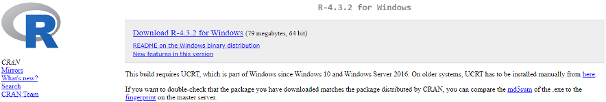

5.  Após o *download*, execute o arquivo baixado e siga as instruções do instalador. Durante a instalação, você pode aceitar as configurações padrão, que são adequadas para a maioria dos usuários.

#### Instalação do RStudio no Windows

1.  Após instalar o R, acesse o site do [RStudio (Posit)](https://posit.co/download/rstudio-desktop/);

2.  Desça a página e clique em "*Download RStudio Desktop for Windows*";

    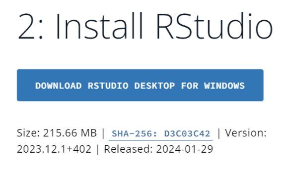{width="334"}

3.  Execute o arquivo baixado e siga as instruções para concluir a instalação.

#### Instalação do R no Mac

1.  Acesse o site do [CRAN](https://cran.r-project.org);

2.  Clique em "*Download R for macOS*";

    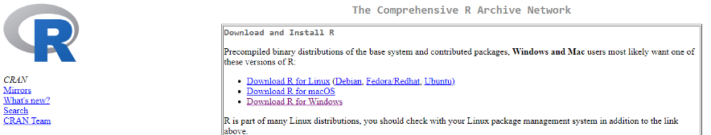

3.  Escolha a versão do R adequada ao processador do seu computador: Apple Silicon (M1 ou posteriores) ou Intel (modelos mais antigos). A informação está em "Sobre este Mac", no menu Apple;

    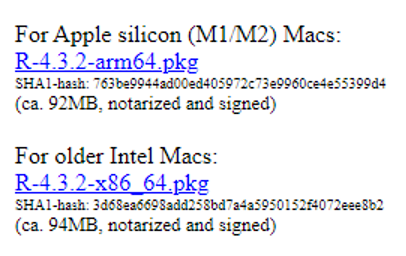{width="259"}

4.  Após o *download*, abra o arquivo ".pkg" baixado e siga as instruções para instalar o R.

#### Instalação do RStudio no Mac

1.  Visite o site do [RStudio (Posit)](https://posit.co/download/rstudio-desktop/) após instalar o R;

2.  Clique em "*Download RStudio*";

3.  Na seção *RStudio Desktop*, clique em "*Download RStudio Desktop for Mac*";

4.  Abra o arquivo baixado e arraste o RStudio para a pasta Aplicativos.

Após a instalação, o R pode ser usado por meio da interface do RStudio, que se divide em quatro painéis: o editor de código, onde os *scripts* são escritos e salvos; o console, onde o código é executado e os resultados aparecem; o ambiente, que lista os objetos criados na sessão; e o visualizador, que mostra gráficos, arquivos, pacotes e a ajuda.

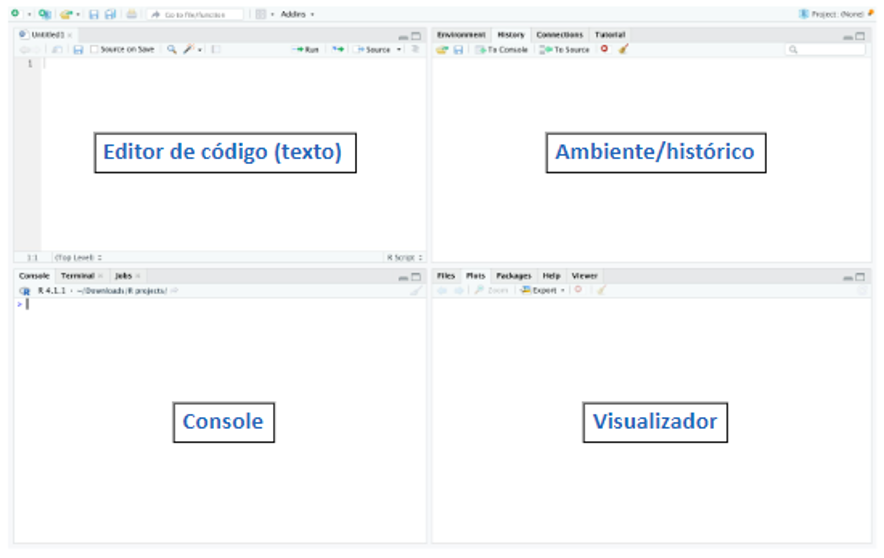{width="100%"}

### Sintaxe básica e operações no R

#### Sintaxe básica

A sintaxe do R é simples. A linguagem faz distinção entre maiúsculas e minúsculas, portanto, "A" e "a" são considerados símbolos diferentes e podem se referir a variáveis diferentes. Os comandos no R são expressões ou atribuições. Se um comando é uma expressão, seu valor é calculado e visualizado, mas é perdido em seguida. Uma atribuição, por outro lado, calcula a expressão e atribui o resultado a uma variável, que é salva no ambiente de trabalho do R. O operador de atribuição recomendado é `<-` (o sinal `=` também funciona na maioria dos casos, mas `<-` é a convenção). Veja um exemplo de atribuição no R ("X <- 1", ou "X recebe o valor 1"):

**Passo 1**: digite o código desejado no editor

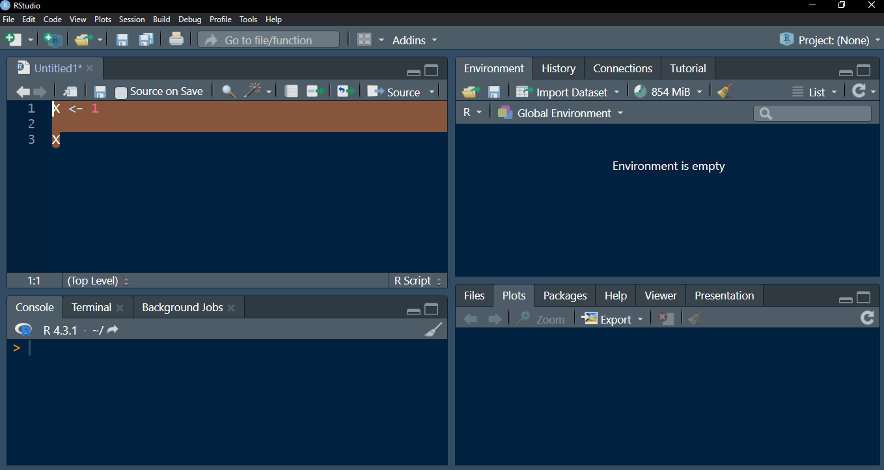

\* O código acima indica, na primeira linha, “X contém o valor 1”. A segunda linha “pede” ao programa que indique o valor de “X”.

**Passo 2**: selecione o código a ser executado e aperte "Ctrl + Enter" (no Mac, "Cmd + Enter")

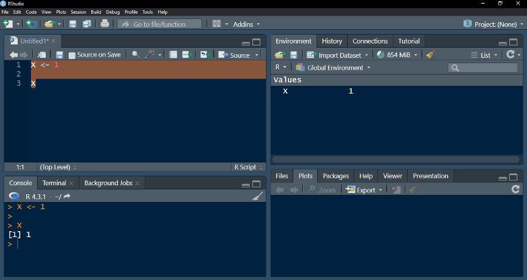

\*O resultado é apresentado no Console (i.e., "[1] 1" ou "X contém um valor, e esse valor é 1"). O "[1]" indica que o valor exibido é o primeiro elemento do resultado.

**Passo 3**: use o objeto X gerado em outros códigos

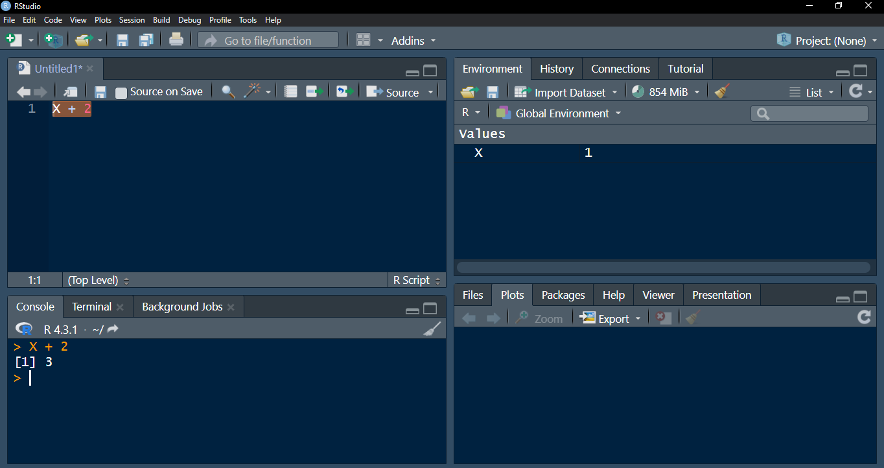

\*”X” é um objeto de valor 1. Se somado a 2, retorna o valor 3.

No restante do livro, os códigos e seus resultados são apresentados como no bloco abaixo: primeiro o código, depois a saída, com as linhas de resultado precedidas por `##`. Você pode copiar o código e executá-lo no seu RStudio.

```{r r7-atribuicao}
X <- 1
X
X + 2
```

As principais estruturas de dados do R são os vetores, as matrizes, as listas e os *data frames* (quadros de dados):

```{r r7-estruturas}
v <- c(1, 2, 3, 4, 5)                                      # vetor
m <- matrix(1:9, nrow = 3, ncol = 3)                        # matriz
l <- list(nome = "João", idade = 30, altura = 1.75)        # lista
df <- data.frame(nome = c("João", "Maria"), idade = c(30, 25))   # data frame
m
l$idade
df
str(df)
```

O vetor é a estrutura mais básica: uma sequência de valores do mesmo tipo (numérico, texto ou lógico). A matriz organiza valores do mesmo tipo em linhas e colunas. A lista reúne elementos de tipos diferentes, acessados pelo nome com o operador `$`. O *data frame* é a estrutura usada para conjuntos de dados: cada coluna é uma variável, que pode ter um tipo diferente das demais, e cada linha é uma observação. A função `str()` mostra a estrutura de um objeto, com o tipo de cada coluna.

#### Operações básicas

O R pode ser usado como uma calculadora, com os operadores aritméticos de adição (`+`), subtração (`-`), multiplicação (`*`), divisão (`/`) e potenciação (`^`), e com os operadores relacionais menor (`<`), menor ou igual (`<=`), maior (`>`), maior ou igual (`>=`), igual (`==`) e diferente (`!=`), que produzem valores lógicos (`TRUE` ou `FALSE`).

```{r r7-operacoes}
3 + 2
5 - 2
3 * 2
6 / 2
2^3
5 > 3
5 == 3
```

As operações também valem para vetores, elemento a elemento. Se dois vetores têm o mesmo comprimento, podem ser somados diretamente:

```{r r7-vetores}
c(1, 2, 3) + c(4, 5, 6)
c(1, 2, 3) * 10
```

#### Manipulação de dados

Os elementos de um vetor são acessados com colchetes (`[]`), pela posição (que começa em 1) ou por uma condição lógica:

```{r r7-indexacao}
x <- c(10, 20, 30, 40, 50)
x[3]
x[c(1, 5)]
x[x > 25]
df[df$idade > 26, ]      # linhas do data frame com idade maior que 26
```

O R também manipula *strings* (cadeias de caracteres):

```{r r7-strings}
nome <- "Maria"
sobrenome <- "Silva"
paste(nome, sobrenome)
toupper(nome)
nchar(sobrenome)
substr(nome, 1, 1) == substr(sobrenome, 1, 1)   # as iniciais são iguais?
```

Valores ausentes são representados por `NA`. Muitas funções retornam `NA` quando há algum valor ausente, a menos que se peça explicitamente para ignorá-los:

```{r r7-na}
pressao <- c(120, 135, NA, 128)
mean(pressao)
mean(pressao, na.rm = TRUE)
sum(is.na(pressao))      # quantos valores ausentes
```

#### Pacotes e ajuda

Funções adicionais são distribuídas em pacotes. Um pacote é **instalado** uma única vez, com `install.packages()`, e **carregado** em cada nova sessão do R, com `library()`. A documentação de qualquer função é aberta com `?` seguido do nome da função.

```{r r7-pacotes, eval=FALSE}
install.packages("ggplot2")   # instala (uma vez por computador)
library(ggplot2)              # carrega (uma vez por sessão)
?mean                         # abre a ajuda da função mean()
```

#### Importando dados

Dados de pesquisa costumam estar em planilhas ou arquivos de texto. Para arquivos CSV, a função `read.csv()` lê arquivos com vírgula como separador de colunas e ponto decimal; a função `read.csv2()` lê o padrão brasileiro, com ponto e vírgula como separador e vírgula decimal. Para planilhas do Excel, usa-se o pacote `readxl`.

```{r r7-importar, eval=FALSE}
dados <- read.csv("dados.csv")                  # separador ",", decimal "."
dados <- read.csv2("dados.csv")                 # separador ";", decimal ","
dados <- readxl::read_excel("dados.xlsx", sheet = 1)
head(dados)      # primeiras linhas
str(dados)       # estrutura e tipos das variáveis
summary(dados)   # resumo de cada variável
```

Depois de importar, verifique sempre se o número de linhas e colunas está correto e se cada variável foi lida com o tipo esperado (números como números, e não como texto). Os cuidados com a organização de dados em planilhas estão na seção *Softwares "no-code" e "low-code"*.

Esses são apenas alguns exemplos da sintaxe básica e das operações no R. Não se preocupe se encontrou erros ou se ainda não conseguiu executar todos os códigos de exemplo: continue a leitura e pratique, que é a forma mais eficaz de aprender a linguagem.

### Escrevendo código eficiente e legível

Código eficiente e legível é mais fácil de manter, de entender e de compartilhar com colaboradores. A seguir estão algumas recomendações práticas, com exemplos, para escrever código mais limpo em R. Um guia de estilo amplamente adotado é o do *tidyverse* (<https://style.tidyverse.org>), e o pacote `styler` formata o código automaticamente segundo ele.

#### Convenções de nomenclatura

Utilize nomes significativos e autoexplicativos para variáveis e funções, e adote uma única convenção. A mais usada em R é a de palavras em minúsculas separadas por sublinhado (*snake_case*):

```{r r7-nomes, eval=FALSE}
# Ruim: nome que não informa o conteúdo
df1 <- read.csv("dados.csv")

# Bom: nome descritivo, em snake_case
dados_clientes <- read.csv("dados_clientes.csv")
```

#### Formatação consistente

Mantenha um padrão de recuo, espaçamento e formatação: espaços em torno de operadores e após vírgulas, e recuo de dois espaços dentro de chaves.

```{r r7-formatacao}
# Ruim
soma<-function(x,y){
return(x+y)
}

# Bom
soma <- function(x, y) {
  x + y
}
soma(2, 3)
```

Em R, a última expressão avaliada dentro de uma função é retornada automaticamente; o `return()` explícito é necessário apenas para sair da função antes do fim.

#### Comentários e documentação

Inclua comentários que expliquem **por que** algo é feito, e não apenas **o que** é feito, o que o próprio código já mostra. Evite comentários óbvios e mantenha-os atualizados:

```{r r7-comentarios}
valores <- c(4.2, 5.1, NA, 6.3)

# Ruim: repete o que o código já diz
# Calcula a média dos valores
media <- mean(valores)

# Bom: explica uma decisão
# Exclui o valor ausente (amostra perdida no transporte; ver protocolo, seção 4.2)
media <- mean(valores, na.rm = TRUE)
media
```

#### Simplicidade e modularidade

Evite complexidade desnecessária e divida o código em funções pequenas e reutilizáveis. Um erro comum é usar a função `ifelse()`, que é vetorizada (aplica a condição a cada elemento de um vetor), quando a decisão envolve uma única condição; nesse caso, a estrutura adequada é `if ... else`:

```{r r7-simplicidade}
classifica_pressao <- function(pas) {
  if (length(pas) != 1) stop("Informe um único valor de pressão.")
  if (pas >= 140) {
    "hipertensão"
  } else {
    "normal ou limítrofe"
  }
}
classifica_pressao(150)

# Para classificar um vetor inteiro, ifelse() é a ferramenta certa
ifelse(c(118, 152, 139) >= 140, "hipertensão", "normal ou limítrofe")
```

#### Tratamento de erros

Verifique as condições que poderiam levar a resultados errados ou falhas inesperadas, e interrompa a execução com uma mensagem clara quando elas ocorrerem:

```{r r7-tratamento, error=TRUE}
# Ruim: não verifica a entrada; log(-5) produz NaN com um aviso pouco informativo
log_seguro_ruim <- function(valor) log(valor)

# Bom: verifica a entrada antes de calcular
log_seguro <- function(valor) {
  if (!is.numeric(valor) || any(valor <= 0, na.rm = TRUE)) {
    stop("O valor deve ser numérico e positivo.")
  }
  log(valor)
}
log_seguro_ruim(-5)
log_seguro(10)
log_seguro(-5)
```

#### Evitar duplicações de código

Quando o mesmo trecho de código aparece repetido com pequenas variações, transforme-o em uma função. Isso reduz erros (uma correção feita em um lugar vale para todos) e torna o código mais curto:

```{r r7-duplicacao}
grupo1 <- c(5.1, 4.8, 5.6, 5.0)
grupo2 <- c(6.2, 5.9, 6.4, 6.1)

# Ruim: o mesmo cálculo repetido
resumo1 <- c(media = mean(grupo1), dp = sd(grupo1), n = length(grupo1))
resumo2 <- c(media = mean(grupo2), dp = sd(grupo2), n = length(grupo2))

# Bom: uma função reutilizável, aplicada a uma lista de grupos
resume <- function(x) c(media = mean(x), dp = sd(x), n = length(x))
sapply(list(grupo1 = grupo1, grupo2 = grupo2), resume)
```

#### Vetorização

R é uma linguagem vetorizada: muitas operações se aplicam a todos os elementos de um vetor de uma só vez, sem o uso explícito de laços (*loops*). O código vetorizado é mais curto, mais legível e, em geral, mais rápido:

```{r r7-vetorizacao}
numeros <- 1:10

# Ruim: laço for para calcular o quadrado de cada número
quadrados <- numeric(length(numeros))
for (i in seq_along(numeros)) {
  quadrados[i] <- numeros[i]^2
}

# Bom: operação vetorizada
quadrados_vet <- numeros^2
identical(quadrados, quadrados_vet)
quadrados_vet
```

Laços não são proibidos em R: são a escolha natural quando cada passo depende do anterior (como em uma simulação sequencial). Mas, para operações que se aplicam independentemente a cada elemento, a forma vetorizada é preferível.

Essas práticas beneficiam tanto o autor do código, quando volta a ele meses depois, quanto outras pessoas que venham a trabalhar com ele.

### Depuração e tratamento de erros em R

Escrever código que funcione corretamente é apenas uma parte do desenvolvimento de software; a outra é garantir que ele continue funcionando e que possa ser corrigido quando surgirem problemas. A seguir estão algumas estratégias e ferramentas para depuração e tratamento de erros em R, com exemplos práticos.

#### Depuração interativa

A depuração interativa permite que você inspecione o estado do seu programa R enquanto ele está sendo executado. A função `traceback()`, executada logo após um erro, lista a sequência de chamadas que levaram a ele, da mais recente para a mais antiga:

```{r r7-traceback, eval=FALSE}
f <- function(x) g(x)
g <- function(x) h(x)
h <- function(x) stop("Erro intencional")
f(10)
traceback()
```

No console, a saída é:

```
Error in h(x) : Erro intencional
4: stop("Erro intencional")
3: h(x)
2: g(x)
1: f(10)
```

A leitura é feita de baixo para cima: `f(10)` chamou `g()`, que chamou `h()`, onde o erro ocorreu. Dependendo de como o código foi executado, o R pode acrescentar a cada linha a referência ao arquivo e à linha de origem. Para inspecionar os valores das variáveis no momento do erro, o RStudio oferece a opção "Rerun with Debug", e o comando `options(error = recover)` abre uma sessão interativa no ponto em que o erro ocorreu. A função `browser()`, inserida dentro de uma função, interrompe a execução naquele ponto e permite examinar os objetos linha a linha.

#### Tratamento de erros com tryCatch

A função `tryCatch()` permite especificar o que deve acontecer quando um erro ou um aviso ocorre, em vez de interromper a execução. É útil, por exemplo, quando uma análise é repetida para muitos conjuntos de dados e uma falha em um deles não deve impedir as demais:

```{r r7-trycatch}
log_tolerante <- function(x) {
  tryCatch(
    log(x),
    warning = function(w) {
      message("Aviso capturado: ", conditionMessage(w))
      NA
    },
    error = function(e) {
      message("Erro capturado: ", conditionMessage(e))
      NA
    }
  )
}
log_tolerante(100)
log_tolerante(-1)      # gera um aviso (logaritmo de número negativo)
log_tolerante("a")     # gera um erro (argumento não numérico)
```

Note a diferença entre os dois casos: `log(-1)` não produz um erro, mas um **aviso** (*warning*) e o valor `NaN`; já `log("a")` produz um **erro**. A função `tryCatch()` trata cada tipo de condição com um manipulador diferente.

#### Logging de erros

Registrar erros em um arquivo (*logging*) é uma prática padrão no desenvolvimento de software, especialmente útil em processos automatizados, aplicativos Shiny ou rotinas executadas sem supervisão. Em R, há pacotes dedicados (como `logger`), mas um registro simples pode ser feito com funções básicas. O exemplo grava cada erro em uma nova linha, com data e hora, sem apagar os registros anteriores:

```{r r7-logging}
arquivo_log <- tempfile(fileext = ".log")   # em um projeto real: "erros.log"

registra_erro <- function(e) {
  linha <- paste(format(Sys.time(), "%Y-%m-%d %H:%M:%S"), conditionMessage(e))
  cat(linha, "\n", file = arquivo_log, append = TRUE)
}

tryCatch(stop("Falha na leitura do arquivo de entrada"), error = registra_erro)
tryCatch(stop("Variável 'idade' não encontrada"), error = registra_erro)
length(readLines(arquivo_log))   # duas linhas registradas
```

#### Debugging com print

Se as ferramentas de depuração não ajudarem, uma alternativa simples é inserir comandos `message()` ou `print()` em pontos estratégicos para acompanhar o fluxo de execução e os valores das variáveis. É um método rudimentar, mas eficaz para localizar onde o problema ocorre:

```{r r7-print, error=TRUE}
f <- function(x) {
  message("Iniciando f com x = ", x)
  g(x)
}
g <- function(x) {
  message("Iniciando g com x = ", x)
  stop("Erro intencional")
}
f(10)
```

As mensagens mostram que a execução passou por `f()` e chegou a `g()`, onde o erro ocorreu. A função `message()` é preferível a `print()` para esse fim, porque suas mensagens podem ser suprimidas (com `suppressMessages()`) sem alterar o código.

Ao escrever suas próprias funções, crie mensagens de erro claras e informativas e documente o significado dos erros que elas podem gerar. Isso economiza tempo de depuração e ajuda a evitar a perda de dados ou de resultados.

### Documentando e compartilhando seu código

Documentar e compartilhar o código facilita a colaboração e a revisão por outras pessoas e ajuda o próprio autor a entender e manter o código ao longo do tempo. Para quem está começando a aprender R, é um hábito que vale adquirir cedo.

#### Documentação de código

A documentação é a primeira linha de comunicação entre o programador e quem vai ler o código depois, seja o próprio autor em um momento futuro ou outros programadores. Em R, a documentação pode ser feita diretamente no código, usando comentários, e de forma mais estruturada, usando pacotes como o "roxygen2" [@wickham2024]. No formato do roxygen2, comentários iniciados por `#'` acima de uma função descrevem o que ela faz, seus parâmetros, o que retorna e exemplos de uso; em um pacote, esses comentários são convertidos automaticamente no manual de ajuda acessado com `?`:

```{r r7-roxygen}
#' Calcula o índice de massa corporal
#'
#' @param peso Massa corporal, em quilogramas.
#' @param altura Estatura, em metros.
#' @return O IMC, em kg/m².
#' @examples
#' imc(70, 1.75)
imc <- function(peso, altura) {
  peso / altura^2
}
imc(70, 1.75)
```

Mesmo fora de um pacote, esse formato é uma forma organizada de documentar as funções de um projeto.

#### Compartilhamento de código

O compartilhamento de código em R pode ser feito de várias maneiras. Uma das mais comuns é através de scripts, que são arquivos de texto com extensão ".R". Esses scripts podem ser compartilhados por e-mail, repositórios de código como GitHub ou plataformas como [RPubs](https://rpubs.com), onde é possível publicar análises e códigos para que outros possam ver e usar. Para que o código funcione em outro computador, informe as versões do R e dos pacotes usados (a função `sessionInfo()` as lista) e evite caminhos de arquivo absolutos, específicos do seu computador; os projetos do RStudio (arquivos `.Rproj`) ajudam nisso, porque definem a pasta do projeto como diretório de trabalho.

#### R Markdown

Uma ferramenta muito usada para documentar e compartilhar análises em R é o R Markdown [@baumer2015]. Com ele, é possível combinar texto com código R que, ao ser executado, gera resultados incluídos automaticamente no documento. Isso é útil em relatórios, onde a análise e os resultados precisam ser apresentados de forma clara e reproduzível. Este livro é escrito em R Markdown. Um bloco de código em um documento R Markdown tem a seguinte forma:

````markdown
`r ''````{r histograma-idade, echo=TRUE, fig.cap="Distribuição da idade dos participantes."}
# Este código gera um histograma da idade
hist(dados$idade, main = "", xlab = "Idade (anos)")
```
````

O bloco começa com três crases seguidas de `{r}`, em que se podem informar um rótulo (`histograma-idade`) e opções (como `echo`, que define se o código aparece no documento, e `fig.cap`, a legenda da figura), e termina com três crases. Ao compilar o documento, o código é executado e o histograma é inserido no lugar do bloco. Números também podem ser inseridos no meio do texto com código *inline*, escrevendo, por exemplo, "a idade média foi de `` `r knitr::inline_expr("round(mean(dados$idade), 1)")` `` anos". O Quarto, sucessor do R Markdown, usa a mesma lógica.

### Introdução à análise estatística com R

O R foi desenvolvido com foco em estatística e análise de dados. Ele inclui técnicas como regressão linear e não linear, análise de séries temporais, classificação e agrupamento, e pode ser estendido por pacotes, bibliotecas de funções desenvolvidas pela comunidade. Esta seção apresenta as funções básicas para cada etapa de uma análise. Os exemplos usam dois vetores com medidas de temperatura (em °C) registradas em oito horários de um dia:

```{r r7-dados-temp}
hora <- c(12.08, 13.10, 14.01, 15.07, 16.12, 17.05, 18.10, 19.15)
temperatura <- c(23.1, 22.4, 23.5, 24.2, 25.1, 23.3, 24.0, 23.2)
```

#### Estatística descritiva

A estatística descritiva é a primeira etapa na análise de dados. Ela envolve resumir e organizar os dados de maneira que possam ser facilmente compreendidos. As funções básicas do R para estatística descritiva incluem `mean()` para calcular a média, `median()` para a mediana, `sd()` para o desvio padrão, `var()` para a variância, `min()` e `max()` para os valores mínimo e máximo, respectivamente, e `summary()` para obter um resumo estatístico dos dados:

```{r r7-descritiva}
mean(temperatura)
median(temperatura)
sd(temperatura)
summary(temperatura)
```

As funções são detalhadas na seção *Usando R para estatísticas descritivas*, adiante, e no capítulo *Bioestatística descritiva*. Tente aplicar essas funções em um novo exemplo (ex.: `vet1 <- c(1, 4, 8, 3, 4, 6, 7, 8, 2, 6, 8, 9, 2, 1)`).

#### Visualização de dados

A visualização de dados é uma parte importante da análise estatística. As funções gráficas básicas do R incluem `plot()` para gráficos de dispersão, `hist()` para histogramas, `boxplot()` para boxplots e `barplot()` para gráficos de barras. O pacote `ggplot2` oferece uma estrutura flexível para criar gráficos complexos e será apresentado na seção *Fundamentos da visualização de dados em R*.

**Exemplo**: usando a função `plot()`

```{r r7-plot, fig.cap="Temperatura em função da hora do dia.", fig.width=5, fig.height=3.8, out.width="65%"}
plot(temperatura ~ hora, xlab = "Hora", ylab = "Temperatura (°C)")
```

A sintaxe `plot(temperatura ~ hora)` equivale a dizer "temperatura em função da hora"; o mesmo resultado é obtido informando qual vetor ocupa cada eixo: `plot(x = hora, y = temperatura)`.

**Exemplo**: criando um histograma com a função `hist()`

```{r r7-hist, fig.cap="Histograma das temperaturas.", fig.width=5, fig.height=3.8, out.width="65%"}
hist(temperatura, main = "", xlab = "Temperatura (°C)", ylab = "Frequência", col = "grey85")
```

Note como temperaturas entre 23,0 e 23,5 °C são mais frequentes do que as demais no período avaliado. Com apenas oito medidas, porém, a forma do histograma depende muito da escolha das classes (veja o capítulo *Bioestatística descritiva*).

**Exemplo**: criando um boxplot com a função `boxplot()`

```{r r7-boxplot, fig.cap="Boxplot das temperaturas.", fig.width=4, fig.height=3.8, out.width="50%"}
boxplot(temperatura, ylab = "Temperatura (°C)", col = "grey90")
```

O diagrama de caixa mostra a mediana (linha central), o primeiro e o terceiro quartis (limites da caixa) e a amplitude dos dados que não são considerados atípicos (hastes). Sua construção e interpretação estão detalhadas no capítulo *Bioestatística descritiva*.

#### Estatística inferencial

A estatística inferencial é o processo de usar os dados de uma amostra para inferir propriedades da população. As funções básicas do R para estatística inferencial incluem `t.test()` para o teste t, `chisq.test()` para o teste do qui-quadrado, `cor.test()` para o teste de correlação e `lm()` para a regressão linear.

**Exemplo**: comparando a temperatura média de duas lâmpadas com o teste t

```{r r7-ttest}
t_lampada1 <- c(38.2, 39.1, 37.8, 38.9, 39.4, 38.5, 38.7)
t_lampada2 <- c(35.1, 34.8, 36.0, 35.6, 34.9, 35.3, 35.7)
teste_lamp <- t.test(t_lampada1, t_lampada2)
teste_lamp
```

Suponhamos que as temperaturas superficiais (°C) de duas lâmpadas tenham sido medidas repetidas vezes. A função `t.test()`, que por padrão aplica o teste de Welch, testa a hipótese de que a diferença entre as médias verdadeiras é igual a 0. A diferença observada foi de `r num(unname(diff(rev(teste_lamp$estimate))), 2)` °C (IC 95%: `r num(teste_lamp$conf.int[1], 2)` a `r num(teste_lamp$conf.int[2], 2)` °C), com valor *p* menor que 0,001: se as temperaturas médias das duas lâmpadas fossem iguais, seria muito improvável observar uma diferença entre as médias amostrais tão grande quanto a observada. Em outras palavras, os dados fornecem forte evidência de que as temperaturas médias das duas lâmpadas são distintas, e o intervalo de confiança indica a magnitude provável dessa diferença.

#### Modelagem estatística

A modelagem estatística é o processo de desenvolver um modelo matemático que descreve a relação entre variáveis. O R fornece várias funções para isso, incluindo `lm()` para regressão linear, `glm()` para modelos lineares generalizados, `aov()` para análise de variância (a função `anova()` produz a tabela de análise de variância de um modelo já ajustado, como em `anova(lm(...))`) e `arima()` para modelagem de séries temporais.

**Exemplo**: avaliando a relação entre estatura e massa corporal com a função `lm()`

```{r r7-lm, fig.cap="Massa corporal em função da estatura, com a reta de mínimos quadrados.", fig.width=5, fig.height=3.8, out.width="65%"}
estatura <- c(170, 172, 174, 177, 179, 181, 182)
massa_corporal <- c(60, 62, 66, 70, 74, 81, 83)
modelo_massa <- lm(massa_corporal ~ estatura)
plot(massa_corporal ~ estatura, xlab = "Estatura (cm)", ylab = "Massa corporal (kg)", pch = 19)
abline(modelo_massa, lty = 2)
summary(modelo_massa)
```

Dados de estatura e massa corporal de sete pessoas foram armazenados em vetores. O gráfico mostra a relação entre as duas variáveis, e a função `abline()`, aplicada ao modelo ajustado por `lm()`, desenha a reta de mínimos quadrados. Segundo o modelo, cada centímetro a mais de estatura está associado a `r num(coef(modelo_massa)[2], 2)` kg a mais de massa corporal, e o $R^2$ (`Multiple R-squared`) indica que `r num(100 * summary(modelo_massa)$r.squared, 0)`% da variação na massa corporal desta amostra é explicada pela relação linear com a estatura. A interpretação completa dessa saída está no capítulo *Análise de dados*.

### Usando R para estatísticas descritivas

As estatísticas descritivas resumem e organizam um conjunto de dados de modo que ele possa ser facilmente compreendido. A seguir, mostramos como calculá-las no R, usando como exemplo o vetor de números de 1 a 5. Outros exemplos estão no capítulo *Bioestatística descritiva*; é recomendável praticar os códigos desta seção no RStudio.

#### Medidas de tendência central

As medidas de tendência central são estatísticas que indicam onde os dados estão centrados. As principais medidas de tendência central são a média, a mediana e a moda.

1.  **Média**: a média de um conjunto de dados é a soma de todos os valores dividida pelo número de valores. No R, é calculada com a função `mean()`.

2.  **Mediana**: a mediana é o valor que divide os dados ao meio quando estão ordenados. No R, é calculada com a função `median()`.

3.  **Moda**: a moda é o valor mais frequente em um conjunto de dados. O R não tem uma função embutida para a moda (a função `mode()` informa o tipo de armazenamento de um objeto, o que é outra coisa), mas ela pode ser obtida com a função `table()` ou com uma função própria, como mostrado no capítulo *Bioestatística descritiva*.

```{r r7-tendencia}
mean(c(1, 2, 3, 4, 5))
median(c(1, 2, 3, 4, 5))
contagens <- table(c(1, 2, 2, 3, 4, 5))
names(contagens)[contagens == max(contagens)]   # moda
```

#### Medidas de dispersão

As medidas de dispersão são estatísticas que indicam o quanto os dados estão espalhados. As principais medidas de dispersão são a variância, o desvio padrão e a amplitude.

1.  **Variância**: indica o quanto os valores se desviam da média. No R, é calculada com a função `var()`, que usa o divisor $n - 1$ (variância amostral).

2.  **Desvio padrão**: é a raiz quadrada da variância e está na mesma unidade dos dados. No R, é calculado com a função `sd()`.

3.  **Amplitude**: é a diferença entre o maior e o menor valor. No R, pode ser calculada com `max() - min()` ou com `diff(range())`.

```{r r7-dispersao}
var(c(1, 2, 3, 4, 5))
sd(c(1, 2, 3, 4, 5))
max(c(1, 2, 3, 4, 5)) - min(c(1, 2, 3, 4, 5))
IQR(c(1, 2, 3, 4, 5))   # amplitude interquartil
```

#### Resumo dos dados

A função `summary()` fornece um resumo estatístico dos dados, com o mínimo, o primeiro quartil, a mediana, a média, o terceiro quartil e o máximo. Aplicada a um *data frame*, resume cada coluna:

```{r r7-summary}
summary(c(1, 2, 3, 4, 5))
summary(data.frame(hora, temperatura))
```

### Estatísticas inferenciais com R

As estatísticas inferenciais permitem fazer generalizações sobre uma população com base em uma amostra de dados. São a base da pesquisa científica quantitativa e da tomada de decisões baseada em dados.

#### Conceitos básicos

Antes de realizar a inferência estatística, é preciso conhecer alguns conceitos básicos, como população, amostra, parâmetro e estimativa. A população é o conjunto completo de observações que estão sendo estudadas, enquanto uma amostra é um subconjunto dessa população. Um parâmetro é uma medida resumida da população, como a média populacional, e uma estimativa é o correspondente calculado a partir da amostra.

#### Testes de hipóteses

Um dos pilares da inferência estatística é o teste de hipóteses. O objetivo é testar uma afirmação (hipótese) sobre um parâmetro populacional. No R, funções como `t.test()`, `chisq.test()` e `aov()` são usadas para realizar diferentes tipos de testes de hipóteses.

Por exemplo, o `t.test()` é usado para comparar as médias de duas amostras. O teste do qui-quadrado (`chisq.test()`) é frequentemente usado para testar a independência entre duas variáveis categóricas. A análise de variância (ANOVA), realizada com a função `aov()` (ou com `anova()` aplicada a um modelo ajustado com `lm()`), é usada para comparar as médias de três ou mais grupos. Os capítulos *Bioestatística inferencial* e *Análise de dados* apresentam esses testes com exemplos resolvidos.

#### Intervalos de confiança

Outra ferramenta importante na inferência estatística é o intervalo de confiança, que indica a faixa de valores do parâmetro populacional compatíveis com os dados. No R, o `t.test()` e outras funções de teste fornecem intervalos de confiança como parte de seus resultados, e a função `confint()` os extrai de modelos ajustados:

```{r r7-ic}
t.test(temperatura)$conf.int     # IC 95% para a temperatura média
confint(modelo_massa)            # IC 95% para os coeficientes da regressão
```

#### Regressão e correlação

A análise de regressão é usada para entender a relação entre variáveis. No R, a função `lm()` é usada para realizar regressão linear, que modela a relação entre uma variável dependente e uma ou mais variáveis independentes. A correlação, que mede a força e a direção da relação linear entre duas variáveis, pode ser calculada com a função `cor()` e testada com `cor.test()`:

```{r r7-cor}
cor(estatura, massa_corporal)
cor(estatura, massa_corporal, method = "spearman")
```

#### Análise de séries temporais

A análise de séries temporais trata de dados coletados ao longo do tempo, em que observações próximas tendem a ser correlacionadas. No R, a função `ts()` cria objetos de séries temporais e a função `arima()` ajusta modelos autorregressivos integrados de médias móveis (ARIMA), usados para descrever a série e prever valores futuros.

**Exemplo**: utilizando a função `arima()` para prever uma série temporal

```{r r7-arima, fig.cap="Série de preços com a previsão de um modelo AR(1) para os três períodos seguintes (pontos preenchidos).", fig.width=6, fig.height=3.8, out.width="75%"}
preco <- c(23.1, 22.4, 23.5, 24.2, 25.1, 23.3, 24.0, 23.2)
serie <- ts(preco, start = 1, frequency = 1)
modelo_ar <- arima(serie, order = c(1, 0, 0))   # modelo autorregressivo de ordem 1
previsao <- predict(modelo_ar, n.ahead = 3)
previsao

horas_previsao <- max(hora) + mean(diff(hora)) * 1:3
plot(hora, preco, type = "o", pch = 1, xlim = c(min(hora), max(horas_previsao)),
     ylim = range(preco, previsao$pred), xlab = "Hora", ylab = "Preço")
lines(c(max(hora), horas_previsao), c(preco[length(preco)], previsao$pred), lty = 2)
points(horas_previsao, previsao$pred, pch = 19)
legend("topleft", legend = c("Observado", "Previsão"), lty = c(1, 2), pch = c(1, 19), bty = "n")
```

Usando os dados de variação do preço de uma ação ao longo de um dia, ajustou-se um modelo autorregressivo de ordem 1, AR(1), e foram previstos os valores para os três períodos seguintes. Note que as previsões se aproximam rapidamente da média da série: com um único termo autorregressivo e uma série curta, o modelo tem pouca informação para prever além dela. O objeto `previsao$se` contém os erros padrão das previsões, que devem sempre acompanhá-las. Uma série de apenas oito observações é útil para ilustrar a sintaxe, mas insuficiente para ajustar e validar um modelo ARIMA em uma análise real.

As funções do R tornam a execução dessas análises simples, mas escolher o método adequado e interpretar os resultados exige conhecimento de teoria estatística, tema dos capítulos de bioestatística deste livro.

### Fundamentos da visualização de dados em R

A visualização ajuda a entender e interpretar os dados e a comunicar os resultados. O R tem várias ferramentas e pacotes dedicados a ela, cujos fundamentos são apresentados a seguir. Os princípios de construção de figuras científicas estão na seção *Visualização de dados e figuras científicas*, ao final deste capítulo.

#### Gráficos base do R

O R possui um sistema de gráficos base que permite criar diversos tipos de gráficos, como gráficos de linhas, barras, histogramas, boxplots e gráficos de dispersão. Esses gráficos são gerados usando funções simples, como `plot()`, `hist()`, `barplot()` e `boxplot()`. Por exemplo, a função `plot()` pode ser usada para criar gráficos de dispersão ou de linhas, dependendo dos argumentos fornecidos. Veja, abaixo, uma lista de gráficos comuns em *Base R*:

1.  **Gráficos de dispersão (scatter plots)**: utilizados para visualizar a relação entre duas variáveis numéricas. A função `plot()` é a mais comum para criar esses gráficos.

2.  **Histogramas**: usados para representar a distribuição de uma única variável numérica. A função `hist()` é utilizada para gerar histogramas.

3.  **Gráficos de linhas**: úteis para visualizar dados ao longo do tempo ou sequências ordenadas. A função `plot()` cria gráficos de linhas com o argumento `type = "l"` (apenas linhas) ou `type = "o"` (linhas e pontos).

4.  **Gráficos de barras**: permitem comparar quantidades entre diferentes grupos. A função `barplot()` é usada para criar gráficos de barras (a função `hist()`, embora também desenhe barras, produz histogramas de variáveis numéricas).

5.  **Boxplots**: fornecem uma representação visual da distribuição de uma variável numérica, destacando a mediana, os quartis e os valores discrepantes. A função `boxplot()` é usada para criar boxplots.

**Exemplo**: criando um gráfico de barras com a função `barplot()`

```{r r7-barplot, fig.cap="Gráfico de barras das frequências de quatro categorias.", fig.width=5.5, fig.height=3.8, out.width="70%"}
frequencias <- c("Categoria A" = 25, "Categoria B" = 17, "Categoria C" = 30, "Categoria D" = 45)
barplot(frequencias,
        main = "Frequência por categoria",
        xlab = "Categorias",
        ylab = "Frequência",
        col = c("#E69F00", "#56B4E9", "#009E73", "#CC79A7"),
        ylim = c(0, 50))
```

Considerando um vetor nomeado com as frequências de quatro categorias, o gráfico de barras é gerado com a função `barplot()`. Os argumentos personalizam o gráfico: `main` é o título; `xlab` e `ylab`, os títulos dos eixos; `col`, as cores de preenchimento das barras (aqui, uma paleta segura para pessoas com deficiência na percepção de cores); e `ylim`, os limites do eixo vertical. Como as categorias já estão identificadas no eixo horizontal, as cores, neste caso, são apenas decorativas, e uma única cor seria igualmente adequada.

#### Personalização de gráficos

Os gráficos base do R podem ser personalizados com argumentos adicionais nas funções gráficas, que modificam títulos, rótulos dos eixos, cores, tipos de linhas e pontos, entre outros elementos. O argumento `main` adiciona um título; `xlab` e `ylab`, rótulos aos eixos X e Y; `col` altera a cor de pontos ou linhas; `pch` define o símbolo dos pontos; `lty`, o tipo de linha; e `lwd`, a espessura da linha.

Também é possível sobrepor elementos gráficos. Funções como `lines()`, `points()`, `abline()`, `text()` e `legend()` acrescentam elementos a um gráfico já criado.

**Exemplo**: sobrepondo elementos gráficos em R base

```{r r7-sobrepor, fig.cap="Gráfico de dispersão com linha e legenda sobrepostas.", fig.width=5.5, fig.height=3.8, out.width="70%"}
plot(temperatura ~ hora, pch = 19, xlab = "Hora", ylab = "Temperatura (°C)")
lines(temperatura ~ hora, col = "grey40")
legend("topleft", legend = "Temperatura (°C)", col = "grey40", lty = 1, pch = 19, lwd = 2, bty = "n")
```

No exemplo, um gráfico de dispersão foi criado com a função `plot()`. Em seguida, a função `lines()` acrescentou uma linha que conecta os pontos, e a função `legend()` criou uma legenda. Note que, na legenda, os argumentos `lty` (tipo de linha, de 1 a 6) e `pch` (símbolo do ponto) devem corresponder aos usados no gráfico.

#### O pacote ggplot2

Uma alternativa ao sistema de gráficos base é o pacote `ggplot2`, baseado nos princípios da "Gramática dos Gráficos". O `ggplot2` constrói gráficos de maneira incremental, adicionando camadas de elementos gráficos. Um gráfico começa com a função `ggplot()`, que recebe os dados e as estéticas (`aes()`, que associam variáveis a eixos, cores, tamanhos), e as camadas são adicionadas com o operador `+`, como `geom_point()` para um gráfico de dispersão ou `geom_histogram()` para um histograma. Lembre-se de que pacotes devem ser instalados no primeiro uso e carregados em cada nova sessão.

**Exemplo**: criando um gráfico básico com a função `ggplot()`

```{r r7-ggplot, fig.cap="Gráfico de dispersão construído com o ggplot2.", fig.width=5, fig.height=3.8, out.width="65%", message=FALSE}
library(ggplot2)
df_temp <- data.frame(hora, temperatura)

ggplot(data = df_temp, aes(x = hora, y = temperatura)) +
  geom_point() +
  labs(x = "Hora", y = "Temperatura (°C)")
```

Primeiro, o pacote `ggplot2` foi carregado. Em seguida, um *data frame* (`df_temp`) foi criado a partir dos vetores `hora` e `temperatura`. O gráfico é construído com `ggplot(data = df_temp, aes(x = hora, y = temperatura))`, que define os dados e os eixos; o `+` acrescenta a camada `geom_point()`, que desenha os pontos, e outra camada, `labs()`, que define os rótulos dos eixos.

Múltiplos gráficos do `ggplot2` podem ser organizados em uma mesma figura. Uma forma de fazê-lo é com a função `ggarrange()`, do pacote `ggpubr`, que permite especificar o número de colunas e linhas e criar uma legenda comum para vários gráficos (por exemplo, `ggarrange(g1, g2, ncol = 2, common.legend = TRUE)`). O pacote `patchwork` é uma alternativa popular, em que os gráficos são combinados com operadores (`g1 + g2`, `g1 / g2`).

**Exemplo**: organizando mais de um gráfico por figura com `ggarrange()`

```{r r7-ggarrange, eval=requireNamespace("ggpubr", quietly = TRUE), fig.cap="Dois gráficos do ggplot2 organizados lado a lado com a função ggarrange().", fig.width=7, fig.height=3.2, message=FALSE}
library(ggpubr)
a <- ggplot(df_temp, aes(x = hora, y = temperatura)) +
  geom_point() +
  labs(x = "Hora", y = "Temperatura (°C)")
b <- ggplot(df_temp, aes(x = temperatura)) +
  geom_histogram(binwidth = 0.5, boundary = 22, fill = "grey70", colour = "white") +
  labs(x = "Temperatura (°C)", y = "Frequência")
ggarrange(a, b, ncol = 2, labels = c("A", "B"))
```

Um segundo gráfico (um histograma, criado com `geom_histogram()`) foi construído. Os dois gráficos foram atribuídos aos objetos `a` e `b`, e a função `ggarrange()` os organizou lado a lado, com rótulos "A" e "B". Tente inverter a ordem dos objetos (`ggarrange(b, a)`) ou dispô-los em uma coluna (`ncol = 1`).

#### Visualização de dados multivariados

Tanto o sistema de gráficos base quanto o `ggplot2` oferecem opções para visualizar dados multivariados. Por exemplo, você pode usar cores, formas ou tamanhos de pontos para representar variáveis adicionais em um gráfico de dispersão. No `ggplot2`, isso é feito especificando estéticas adicionais dentro da função `aes()`.

A facetação, no `ggplot2`, divide os dados em subconjuntos e desenha cada subconjunto em seu próprio painel dentro do gráfico, o que facilita a comparação entre subgrupos. Ela é feita com as funções `facet_wrap()` ou `facet_grid()`.

**Exemplo**: utilizando `facet_grid()` para dividir um gráfico em painéis

```{r r7-facet, fig.cap="Vendas trimestrais de dois produtos em três regiões, com um painel por região.", fig.width=6.5, fig.height=5, out.width="85%"}
dados_vendas <- data.frame(
  produto = rep(c("Produto A", "Produto B"), each = 12),
  regiao = rep(rep(c("Norte", "Sul", "Leste"), each = 4), times = 2),
  trimestre = rep(c("T1", "T2", "T3", "T4"), times = 6),
  vendas = c(200, 180, 160, 220, 210, 150, 190, 230, 170, 190, 180, 210,
             220, 190, 200, 240, 230, 200, 200, 250, 180, 210, 210, 220)
)
head(dados_vendas)

ggplot(dados_vendas, aes(x = trimestre, y = vendas, group = produto,
                         colour = produto, shape = produto)) +
  geom_line() +
  geom_point(size = 2) +
  scale_colour_manual(values = c("Produto A" = "#D55E00", "Produto B" = "#0072B2")) +
  facet_grid(regiao ~ .) +
  labs(title = "Vendas por produto e região", x = "Trimestre", y = "Vendas",
       colour = "Produto", shape = "Produto") +
  theme_minimal()
```

O código cria um conjunto de dados com quatro variáveis: `produto`, que repete "Produto A" e "Produto B" doze vezes cada; `regiao`, com as três regiões, cada uma com quatro trimestres, para cada produto; `trimestre`, que repete a sequência dos quatro trimestres seis vezes; e `vendas`, com os valores de cada combinação. A função `head()` mostra as primeiras linhas, para conferir que a estrutura está correta: é sempre recomendável verificar a correspondência entre as variáveis criadas com `rep()`. No gráfico, o eixo x representa os trimestres e o eixo y as vendas; as linhas e os pontos são agrupados e diferenciados por cor **e** por forma de acordo com o produto (de modo que a distinção não depende apenas da cor), e o gráfico é dividido em painéis por região com a função `facet_grid()`. Por fim, são definidas cores manuais (de uma paleta segura para daltônicos), títulos e um tema visual (`theme_minimal()`).

#### Extensões do ggplot2

Existem vários pacotes que estendem as capacidades do `ggplot2`, adicionando novos tipos de gráficos ou funcionalidades. Por exemplo, a função `ggplotly()`, do pacote `plotly`, converte gráficos do `ggplot2` em gráficos interativos, e o pacote `gganimate` cria animações a partir de gráficos do `ggplot2`.

**Exemplo**: criando um gráfico interativo a partir de um ggplot com `ggplotly()`

```{r r7-plotly, eval=knitr::is_html_output() && requireNamespace("plotly", quietly = TRUE), message=FALSE, out.width="100%"}
library(plotly)
grafico_vendas <- ggplot(dados_vendas, aes(x = trimestre, y = vendas, group = produto,
                                           colour = produto)) +
  geom_line() +
  geom_point() +
  facet_grid(regiao ~ .) +
  labs(x = "Trimestre", y = "Vendas", colour = "Produto") +
  theme_minimal()
ggplotly(grafico_vendas)
```

Para criar o gráfico interativo, basta carregar o pacote `plotly`, atribuir o gráfico do `ggplot2` a um objeto (aqui, `grafico_vendas`) e fornecê-lo à função `ggplotly()`. O gráfico resultante permite ampliar regiões, ocultar séries clicando na legenda, ver os valores ao passar o cursor sobre os pontos e salvar a imagem. Gráficos interativos funcionam apenas em documentos HTML; por isso, este exemplo aparece somente na versão *online* deste livro.

#### Visualização de dados geoespaciais

A visualização de dados geoespaciais é outra técnica que pode ser realizada em R, utilizando o `ggplot2` em conjunto com o pacote `sf` [@pebesma2024] para criar mapas. Esses mapas podem representar desde a distribuição geográfica de eventos até análises espaciais complexas, como agrupamentos ou padrões de movimento. Para mapas do Brasil com divisões administrativas (estados, municípios, setores censitários), o pacote `geobr`, desenvolvido pelo Instituto de Pesquisa Econômica Aplicada (Ipea), fornece os limites oficiais.

**Exemplo**: criando um mapa a partir de dados geoespaciais com o pacote `sf`

```{r r7-mapa, eval=requireNamespace("sf", quietly = TRUE) && requireNamespace("rnaturalearth", quietly = TRUE) && requireNamespace("rnaturalearthhires", quietly = TRUE), fig.cap="Mapa do Brasil construído com os pacotes sf, rnaturalearth e ggplot2.", fig.width=5, fig.height=5, out.width="60%", message=FALSE}
library(sf)
geo_brasil <- rnaturalearth::ne_countries(scale = "large", country = "Brazil",
                                          returnclass = "sf")
ggplot(data = geo_brasil) +
  geom_sf(colour = "darkgreen", fill = "gold") +
  theme_minimal() +
  labs(title = "Mapa do Brasil")
```

O código utiliza os pacotes `ggplot2`, `sf` e `rnaturalearth` para criar um mapa do Brasil. A função `ne_countries()` obtém os limites geográficos do país em alta resolução (`scale = "large"`, que exige o pacote complementar `rnaturalearthhires`) no formato `sf`, o padrão para dados espaciais no R. O objeto resultante é passado para a função `ggplot()`, e a camada `geom_sf()` desenha o polígono, com a cor da borda e do preenchimento definidas pelos argumentos `colour` e `fill`. O tema `theme_minimal()` e a função `labs()` completam o gráfico. O mesmo princípio vale para mapas temáticos (*choropleth*), em que o preenchimento de cada região representa o valor de uma variável, como uma taxa de incidência por município.

#### Animações com gganimate

O pacote `gganimate` [@pedersen2024] estende as capacidades do `ggplot2`, permitindo criar animações a partir de gráficos. Isso é útil para visualizar mudanças nos dados ao longo do tempo, como tendências econômicas, padrões climáticos ou o progresso de uma epidemia.

**Exemplo**: criando um gráfico animado com o pacote `gganimate`

```{r r7-gganimate, eval=knitr::is_html_output() && requireNamespace("gganimate", quietly = TRUE) && requireNamespace("gapminder", quietly = TRUE) && requireNamespace("gifski", quietly = TRUE), message=FALSE, out.width="100%"}
library(gapminder)
library(gganimate)
ggplot(gapminder, aes(gdpPercap, lifeExp, size = pop, colour = country)) +
  geom_point(alpha = 0.7, show.legend = FALSE) +
  scale_colour_manual(values = country_colors) +
  scale_size(range = c(2, 12)) +
  scale_x_log10() +
  facet_wrap(~continent) +
  labs(title = "Ano: {frame_time}", x = "PIB per capita (escala log)",
       y = "Expectativa de vida (anos)") +
  transition_time(year) +
  ease_aes("linear")
```

O exemplo usa os dados do pacote `gapminder` [@bryan2023], que reúne, para diferentes países e anos, o PIB per capita, a expectativa de vida e o tamanho da população. A função `ggplot()` define as variáveis dos eixos, o tamanho dos pontos (população) e a cor (país); `geom_point()` desenha os pontos com transparência e sem legenda; `scale_colour_manual()` usa a paleta de cores por país fornecida pelo pacote (`country_colors`); `scale_size()` ajusta o intervalo de tamanhos; `scale_x_log10()` coloca o eixo x em escala logarítmica; e `facet_wrap()` divide o gráfico por continente. As funções específicas do `gganimate` são `transition_time()`, que define a variável que conduz a animação (o ano), e `ease_aes()`, que controla a transição entre os quadros; no título, `{frame_time}` é substituído pelo ano de cada quadro. A animação é gerada como um arquivo GIF (o que exige o pacote `gifski`) e, por isso, aparece apenas na versão *online* deste livro.

#### Dashboards interativos com Shiny

O pacote `shiny` [@chang2024] permite criar aplicativos web interativos diretamente em R. Esses *dashboards* podem incluir diversos elementos de entrada e saída, com os quais os usuários interagem com os dados e as visualizações em tempo real.

**Exemplo**: aplicação shiny para metanálises criada em RStudio

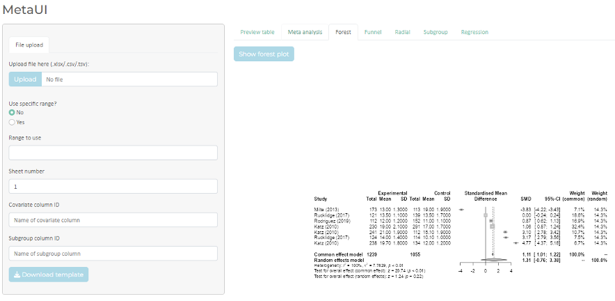

\*A produção de aplicações e *dashboards shiny* é um processo mais complexo do que os exemplos vistos anteriormente. Sua utilização, porém, permite a criação de ferramentas especializadas para pesquisa, trabalho e negócios. Depois de criadas, essas aplicações podem poupar muitas horas de trabalho de um analista ou até mesmo permitir que pessoas sem o conhecimento de programação possam realizar as análises necessárias.

Um aplicativo Shiny tem duas partes: a **interface** (`ui`), que define os elementos que o usuário vê e com os quais interage, e o **servidor** (`server`), que define como as saídas são calculadas a partir das entradas. O exemplo mínimo a seguir cria um aplicativo com um controle deslizante que define o número de classes de um histograma:

```{r r7-shiny, eval=FALSE}
library(shiny)

ui <- fluidPage(
  titlePanel("Histograma interativo"),
  sliderInput("classes", "Número de classes:", min = 2, max = 30, value = 10),
  plotOutput("histograma")
)

server <- function(input, output) {
  output$histograma <- renderPlot({
    hist(faithful$waiting, breaks = input$classes, col = "grey80", border = "white",
         main = "", xlab = "Tempo entre erupções (min)")
  })
}

shinyApp(ui = ui, server = server)
```

Ao executar esse código no RStudio, o aplicativo abre em uma janela; a cada movimento do controle, o histograma é redesenhado. O conjunto de dados `faithful`, que acompanha o R, registra o tempo entre erupções de um gêiser e é usado aqui apenas como exemplo.

#### Tabelas e quadros em R

Para criar tabelas no R, podemos usar a função `table()` para tabular dados e a função `View()` (com "V" maiúsculo) para visualizar *data frames* em formato de planilha. Uma forma de visualizar seus dados sem a utilização da função `View()` é clicar no ícone de uma tabela ou uma lupa:


que aparecem na aba “Environment” da janela superior direita.

```{r r7-table}
table(dados_vendas$regiao, dados_vendas$produto)
```

O pacote `knitr` [@xieaut2024] oferece ainda a função `kable()`, que cria tabelas formatadas para relatórios e documentos, e o pacote `kableExtra` acrescenta opções de estilo.

**Exemplo**: criando uma tabela com a função `kable()`

```{r r7-kable}
library(knitr)
vendas_t1 <- subset(dados_vendas, trimestre == "T1")
kable(vendas_t1, caption = "Vendas no primeiro trimestre, por produto e região.",
      row.names = FALSE)
```

Usando os dados do exemplo anterior, filtrados para o primeiro trimestre com a função `subset()`, a função `kable()` produziu uma tabela formatada, com legenda. Em documentos HTML, a função `kable_classic()`, do pacote `kableExtra`, aplica um estilo clássico à tabela:

```{r r7-kable-classic, eval=FALSE}
kableExtra::kable_classic(kable(vendas_t1))
```

O prefixo `kableExtra::` permite chamar a função sem carregar o pacote inteiro com `library()`. Para tabelas mais elaboradas, como a "Tabela 1" de características da amostra, pacotes como `gtsummary` e `flextable` são boas opções.

## Python para análise estatística

### Visão geral

Python é uma linguagem de programação de uso geral, criada por Guido van Rossum no início da década de 1990, que se tornou uma das mais populares do mundo. Ao contrário do R, que nasceu para a estatística, o Python foi concebido como linguagem genérica, e sua capacidade para análise de dados vem de um conjunto de bibliotecas desenvolvidas pela comunidade:

- **NumPy** [@harris2020]: vetores e matrizes numéricas e operações matemáticas eficientes; é a base das demais;
- **pandas** [@mckinney2010]: estruturas de dados tabulares (*data frames*), leitura de arquivos, limpeza, transformação e agregação de dados;
- **SciPy** [@virtanen2020]: funções científicas, incluindo distribuições de probabilidade e testes estatísticos clássicos (módulo `scipy.stats`);
- **statsmodels** [@seabold2010]: modelos estatísticos (regressão linear, modelos lineares generalizados, modelos mistos, análise de sobrevivência, séries temporais), com saídas semelhantes às do R e especificação por fórmulas;
- **matplotlib** [@hunter2007] e **seaborn**: gráficos;
- **scikit-learn**: aprendizado de máquina (classificação, regressão, agrupamento, validação cruzada).

As seções a seguir percorrem o mesmo caminho da seção sobre o R: instalação, sintaxe, manipulação de dados, boas práticas, estatística descritiva e inferencial, modelos, gráficos e relatórios reprodutíveis. Os blocos de código desta seção **não** são executados durante a compilação do livro, que é feita em R; eles foram executados separadamente, com as versões indicadas abaixo, e a saída de cada bloco é reproduzida logo após o código. Sempre que possível, os exemplos usam os mesmos dados dos capítulos de bioestatística, para que o leitor compare os resultados com os obtidos no R.

### R ou Python?

A pergunta é frequente e a resposta depende do contexto. O R tem a maior coleção de métodos estatísticos especializados (bioestatística, epidemiologia, análise de sobrevivência, metanálise, modelos mistos), muitos dos quais aparecem primeiro no CRAN ou no Bioconductor, e uma tradição forte em gráficos estatísticos e relatórios reprodutíveis. O Python é mais forte em aprendizado de máquina e aprendizado profundo, processamento de imagens e textos, integração com sistemas e programação de uso geral. Para a maioria das análises de pesquisa clínica e epidemiológica deste livro, as duas linguagens são adequadas. O mais importante é escolher uma, aprendê-la bem e escrever código reprodutível. É possível, também, combinar as duas: no R, o pacote `reticulate` executa código Python; no Python, o pacote `rpy2` executa código R.

### Instalando o Python e o ambiente de trabalho

Há dois caminhos principais para instalar o Python com as bibliotecas científicas.

1. **Distribuições Anaconda ou Miniconda.** Incluem o Python, um gerenciador de pacotes e ambientes (`conda`) e, no caso da Anaconda, centenas de bibliotecas científicas já instaladas. São a opção mais simples para iniciantes em Windows e Mac. A Miniconda instala apenas o essencial, e as bibliotecas são acrescentadas conforme a necessidade.
2. **Instalador oficial** de <https://www.python.org> e o gerenciador de pacotes `pip`. No Mac e no Linux, o Python frequentemente já vem instalado, mas essa versão do sistema não deve ser usada para análises: instale uma versão própria.

Em qualquer dos casos, recomenda-se trabalhar em **ambientes virtuais**: cada projeto tem seu próprio conjunto de bibliotecas, com versões fixas, isolado dos demais. Isso evita que a atualização de uma biblioteca para um projeto quebre outro, e permite registrar exatamente o que foi usado. Com o `pip`:

```bash
python -m venv ambiente_estatistica
source ambiente_estatistica/bin/activate     # no Windows: ambiente_estatistica\Scripts\activate
pip install numpy pandas scipy statsmodels matplotlib seaborn scikit-learn jupyter
pip freeze > requirements.txt                # registra as versões instaladas
```

Com o `conda`, o equivalente é `conda create -n estatistica python numpy pandas scipy statsmodels matplotlib seaborn scikit-learn jupyterlab` seguido de `conda activate estatistica`.

Para escrever e executar código, as opções mais usadas são:

- **JupyterLab** ou **Jupyter Notebook**: ambiente no navegador em que código, resultados, gráficos e texto ficam no mesmo documento (*notebook*), ótimo para análises exploratórias e para o ensino;
- **Visual Studio Code**: editor gratuito com extensões para Python e para *notebooks*, adequado tanto a *scripts* quanto a projetos maiores;
- **Spyder**: ambiente semelhante ao RStudio, com editor, console e painel de variáveis, que acompanha a Anaconda;
- **RStudio**: também executa código Python, por meio do pacote `reticulate`, o que é conveniente para quem já trabalha em R.

Para verificar a instalação e registrar as versões em uso:

```python
import sys
import numpy as np
import pandas as pd
import scipy
import statsmodels
import matplotlib
import seaborn as sns
import sklearn

print("Python", sys.version.split()[0])
for nome, modulo in [("numpy", np), ("pandas", pd), ("scipy", scipy),
                     ("statsmodels", statsmodels), ("matplotlib", matplotlib),
                     ("seaborn", sns), ("scikit-learn", sklearn)]:
    print(f"{nome:12s} {modulo.__version__}")
```

Saída:

```
Python 3.13.16
numpy        2.5.3
pandas       3.0.5
scipy        1.18.1
statsmodels  0.15.0
matplotlib   3.11.2
seaborn      0.13.2
scikit-learn 1.9.1
```

Os exemplos desta seção foram executados com essas versões. Versões diferentes podem produzir pequenas diferenças na formatação das saídas e, ocasionalmente, nos argumentos padrão das funções; por isso, registrar as versões é parte da reprodutibilidade.

### Sintaxe básica e operações em Python

#### Tipos de dados e operações

Algumas diferenças em relação ao R surpreendem quem conhece as duas linguagens:

- os índices começam em **0**, e não em 1: o primeiro elemento de uma lista `x` é `x[0]`;
- a **indentação** (o recuo das linhas) faz parte da sintaxe: define os blocos de código dentro de funções, laços e condicionais;
- o operador de atribuição é `=`, e a potência é `**` (e não `^`, que em Python é outra operação);
- as funções das bibliotecas são chamadas pelo nome da biblioteca, ou de uma abreviação definida na importação, como em `np.mean(x)` ou em `pd.read_csv("dados.csv")`;
- texto entre aspas simples ou duplas é uma *string*; os valores lógicos são `True` e `False`, com inicial maiúscula; a ausência de valor é `None`.

```python
idade = 54                  # número inteiro (int)
imc = 27.3                  # número real (float)
sexo = "Feminino"           # texto (str)
hipertensa = True           # valor lógico (bool)

print(type(idade), type(imc), type(sexo), type(hipertensa))
print(7 / 2, 7 // 2, 7 % 2, 2 ** 10)   # divisão, divisão inteira, resto, potência
print(f"Paciente de {idade} anos com IMC de {imc:.1f} kg/m²")
```

Saída:

```
<class 'int'> <class 'float'> <class 'str'> <class 'bool'>
3.5 3 1 1024
Paciente de 54 anos com IMC de 27.3 kg/m²
```

A última linha usa uma ***f-string***: o `f` antes das aspas permite inserir valores entre chaves, com formatação opcional (`:.1f` indica uma casa decimal).

#### Listas, dicionários e laços

As estruturas de dados básicas do Python são as **listas** (sequências ordenadas e modificáveis, entre colchetes), as **tuplas** (sequências que não podem ser modificadas, entre parênteses) e os **dicionários** (pares de chave e valor, entre chaves).

```python
tempos = [3, 4, 4, 5, 6, 8, 19]          # lista
print(tempos[0], tempos[-1], tempos[1:3])  # primeiro, último e fatia (posições 1 e 2)

paciente = {"id": 101, "idade": 54, "pas": 142}   # dicionário
print(paciente["pas"])

for t in tempos:                          # laço
    if t > 7:
        print("Internação longa:", t, "dias")

longos = [t for t in tempos if t > 7]     # compreensão de lista
print(longos)
```

Saída:

```
3 19 [4, 4]
142
Internação longa: 8 dias
Internação longa: 19 dias
[8, 19]
```

Note dois detalhes: a fatia `tempos[1:3]` inclui a posição 1 e **exclui** a posição 3; e o índice `-1` indica o último elemento. A **compreensão de lista** da última linha é uma forma concisa e muito usada de construir uma lista a partir de outra.

#### Funções

Funções são definidas com `def`, e o corpo da função é delimitado pela indentação. Uma *docstring* (texto entre aspas triplas logo após a definição) documenta o que a função faz.

```python
def coeficiente_variacao(valores):
    """Calcula o coeficiente de variação (%), com desvio padrão amostral."""
    n = len(valores)
    media = sum(valores) / n
    variancia = sum((v - media) ** 2 for v in valores) / (n - 1)
    return 100 * variancia ** 0.5 / media

print(round(coeficiente_variacao(tempos), 1))
```

Saída:

```
79.1
```

#### Vetores com NumPy

Listas do Python não fazem operações vetorizadas: `tempos * 2` repete a lista duas vezes, em vez de multiplicar cada elemento. Para cálculos numéricos, usam-se os *arrays* do NumPy, que se comportam como os vetores do R.

```python
import numpy as np

pressao = np.array([118, 124, 122, 130, 129, 133])
print(pressao * 2)
print(pressao - pressao.mean())
print(pressao.mean(), np.median(pressao), pressao.std(ddof=1))
print(pressao[pressao > 125])     # seleção por condição lógica
```

Saída:

```
[236 248 244 260 258 266]
[-8. -2. -4.  4.  3.  7.]
126.0 126.5 5.621387729022079
[130 129 133]
```

Note o argumento `ddof=1` ("graus de liberdade delta"): por padrão, a função `std()` do NumPy calcula o desvio padrão com divisor $n$; para obter o desvio padrão amostral, com divisor $n - 1$ (capítulo *Bioestatística descritiva*), é preciso especificar `ddof=1`. A função `std()` do pandas, ao contrário, usa $n - 1$ por padrão. Diferenças como essa são uma fonte comum de discrepâncias entre programas, e conhecê-las faz parte do uso responsável de qualquer ferramenta.

### Manipulação de dados com pandas

#### Criando e importando dados

O objeto central do pandas é o `DataFrame`, uma tabela em que cada coluna é uma variável, equivalente ao `data.frame` do R. Dados reais são lidos de arquivos com funções como `pd.read_csv()`, `pd.read_excel()` e `pd.read_stata()`. Para os exemplos, simulamos um conjunto de 200 pacientes, com um gerador de números aleatórios com semente fixa, para que os resultados sejam reproduzíveis.

```python
import pandas as pd

rng = np.random.default_rng(2024)        # gerador com semente fixa
n = 200
pacientes = pd.DataFrame({
    "id": np.arange(1, n + 1),
    "sexo": rng.choice(["Feminino", "Masculino"], size=n, p=[0.55, 0.45]),
    "idade": rng.normal(61, 12, size=n).round(),
    "imc": rng.normal(27.5, 4.5, size=n).round(1),
    "tabagismo": rng.choice(["Nunca", "Ex-fumante", "Atual"], size=n, p=[0.5, 0.3, 0.2]),
})
pacientes["pas"] = (95 + 1.4 * pacientes["imc"] + 0.2 * pacientes["idade"]
                    + rng.normal(0, 12, size=n)).round()
pacientes.loc[rng.choice(n, size=6, replace=False), "imc"] = np.nan   # alguns valores faltantes

print(pacientes.shape)
print(pacientes.head())
```

Saída:

```
(200, 6)
   id       sexo  idade   imc   tabagismo    pas
0   1  Masculino   44.0  31.2  Ex-fumante  143.0
1   2   Feminino   54.0  25.7       Atual  142.0
2   3   Feminino   63.0  26.5       Nunca  136.0
3   4  Masculino   49.0  32.7       Nunca  167.0
4   5  Masculino   41.0  27.1  Ex-fumante  161.0
```

A leitura de um arquivo real seria feita, por exemplo, com o comando abaixo, em que os argumentos `sep` e `decimal` permitem ler arquivos no padrão brasileiro, com ponto e vírgula como separador e vírgula como separador decimal:

```python
pacientes = pd.read_csv("pacientes.csv", sep=";", decimal=",")
```

#### Selecionando, filtrando e criando variáveis

```python
print(pacientes["idade"].head(3))                       # uma coluna
print(pacientes[["idade", "pas"]].head(3))              # várias colunas
idosos = pacientes[pacientes["idade"] >= 65]            # filtro por condição
print(len(idosos))
fumantes_idosos = pacientes.query("idade >= 65 and tabagismo == 'Atual'")
print(len(fumantes_idosos))

pacientes["hipertenso"] = pacientes["pas"] >= 140       # nova variável lógica
pacientes["faixa_imc"] = pd.cut(pacientes["imc"], bins=[0, 18.5, 25, 30, np.inf],
                                labels=["Baixo peso", "Eutrofia", "Sobrepeso", "Obesidade"],
                                right=False)
print(pacientes[["imc", "faixa_imc"]].head())
```

Saída:

```
0    44.0
1    54.0
2    63.0
Name: idade, dtype: float64
   idade    pas
0   44.0  143.0
1   54.0  142.0
2   63.0  136.0
70
19
    imc  faixa_imc
0  31.2  Obesidade
1  25.7  Sobrepeso
2  26.5  Sobrepeso
3  32.7  Obesidade
4  27.1  Sobrepeso
```

A função `pd.cut()` agrupa uma variável contínua em classes; com `right=False`, os intervalos são fechados à esquerda e abertos à direita, como na convenção $[a, b)$ do capítulo *Bioestatística descritiva*. Note que o valor faltante de IMC continua faltante na nova variável.

#### Agrupando e resumindo

A combinação `groupby()` e `agg()` corresponde ao `group_by()` e `summarise()` do *tidyverse* no R.

```python
resumo = (pacientes
          .groupby("tabagismo")
          .agg(n=("id", "size"),
               idade_media=("idade", "mean"),
               pas_media=("pas", "mean"),
               pas_dp=("pas", "std"),
               prop_hipertensos=("hipertenso", "mean"))
          .round(2))
print(resumo)
```

Saída:

```
             n  idade_media  pas_media  pas_dp  prop_hipertensos
tabagismo                                                       
Atual       49        61.33     147.04   13.39              0.69
Ex-fumante  58        58.88     144.69   14.18              0.66
Nunca       93        61.54     149.14   14.36              0.80
```

Os parênteses em volta da expressão permitem encadear operações em várias linhas, uma por linha, o que facilita a leitura. Como `hipertenso` é uma variável lógica, sua média é a proporção de valores verdadeiros.

#### Dados faltantes e variáveis categóricas

```python
print(pacientes.isna().sum())                     # número de faltantes por coluna
print(pacientes["imc"].mean())                    # pandas ignora faltantes por padrão
print(np.mean(pacientes["imc"].to_numpy()))       # NumPy não: o resultado é nan

pacientes["tabagismo"] = pd.Categorical(pacientes["tabagismo"],
                                        categories=["Nunca", "Ex-fumante", "Atual"],
                                        ordered=True)
print(pacientes["tabagismo"].value_counts(sort=False))
```

Saída:

```
id            0
sexo          0
idade         0
imc           6
tabagismo     0
pas           0
hipertenso    0
faixa_imc     6
dtype: int64
27.833505154639173
nan
tabagismo
Nunca         93
Ex-fumante    58
Atual         49
Name: count, dtype: int64
```

Aqui há outra diferença de comportamento a conhecer: o pandas ignora valores faltantes (`NaN`) por padrão ao calcular médias e outras estatísticas, o equivalente a `na.rm = TRUE` no R, enquanto o NumPy os propaga. Ignorar faltantes silenciosamente pode esconder problemas; por isso, verifique sempre quantos valores faltam (`isna().sum()`) antes de resumir os dados. A conversão para `Categorical`, com as categorias na ordem desejada, é o equivalente ao `factor` do R.

### Escrevendo código legível e reprodutível

Os princípios apresentados para o R valem igualmente para o Python. Alguns aspectos específicos:

- **Estilo.** A comunidade Python segue um guia de estilo oficial, o **PEP 8**: nomes de variáveis e funções em minúsculas separadas por sublinhado (`pressao_sistolica`, `calcula_imc`), quatro espaços de indentação, linhas de até 79 caracteres, espaços em torno de operadores. Ferramentas como `black` e `ruff` formatam e verificam o código automaticamente.
- **Documentação.** Funções devem ter *docstrings* que descrevam o que fazem, seus argumentos e o que retornam.
- **Sementes aleatórias.** Use um gerador explícito com semente fixa, `rng = np.random.default_rng(semente)`, e passe esse gerador para as funções que sorteiam valores. Isso torna simulações e reamostragens reproduzíveis. Note que as sementes não são compatíveis entre linguagens: `set.seed(2024)` no R e `default_rng(2024)` no Python produzem sequências diferentes, e por isso os dados simulados desta seção não são os mesmos dos capítulos anteriores.
- **Ambientes e versões.** Registre as versões das bibliotecas (`pip freeze > requirements.txt` ou `conda env export > environment.yml`), porque mudanças de versão podem alterar resultados e argumentos padrão.
- **Controle de versões.** Use o Git para registrar a história do código, como no R.

**Erros e exceções.** Quando algo dá errado, o Python interrompe a execução e mostra um ***traceback***: a sequência de chamadas que levou ao erro, terminando com o tipo do erro e uma mensagem. A informação mais útil está na **última linha**. Erros previsíveis podem ser tratados com `try` e `except`, o equivalente ao `tryCatch()` do R:

```python
def converte_numero(texto):
    """Converte texto em número, aceitando vírgula decimal; devolve None se não for possível."""
    try:
        return float(texto.replace(",", "."))
    except ValueError:
        print(f"Valor inválido: {texto!r}")
        return None

valores = ["12,5", "13.1", "não informado", "14"]
print([converte_numero(v) for v in valores])
```

Saída:

```
Valor inválido: 'não informado'
[12.5, 13.1, None, 14.0]
```

### Estatística descritiva com Python

As medidas do capítulo *Bioestatística descritiva* estão disponíveis no NumPy, no pandas e no módulo `scipy.stats`. Retomamos o exemplo do tempo de internação de sete pacientes daquele capítulo:

```python
from scipy import stats

tempo7 = np.array([3, 4, 4, 5, 6, 8, 19])
print("média:", tempo7.mean(), " mediana:", np.median(tempo7))
print("moda:", stats.mode(tempo7).mode)
print("variância:", round(tempo7.var(ddof=1), 3), " DP:", round(tempo7.std(ddof=1), 3))
print("quartis (padrão, 'linear'):", np.quantile(tempo7, [0.25, 0.5, 0.75]))
print("quartis (método 'weibull'):", np.quantile(tempo7, [0.25, 0.5, 0.75], method="weibull"))
print("AIQ:", stats.iqr(tempo7))
print("MAD bruto:", stats.median_abs_deviation(tempo7),
      " MAD escalado:", round(stats.median_abs_deviation(tempo7, scale="normal"), 4))
```

Saída:

```
média: 7.0  mediana: 5.0
moda: 4
variância: 30.667  DP: 5.538
quartis (padrão, 'linear'): [4. 5. 7.]
quartis (método 'weibull'): [4. 5. 8.]
AIQ: 3.0
MAD bruto: 1.0  MAD escalado: 1.4826
```

Os resultados coincidem com os do R: média 7, mediana 5, moda 4, variância 30,67 e desvio padrão 5,54. Os quartis mostram de novo que existem várias definições de quantil amostral. O método padrão do NumPy (`"linear"`) é o tipo 7 do R e produz $Q_3 = 7$; o método `"weibull"` corresponde ao tipo 6 (o padrão do SPSS) e produz $Q_3 = 8$, exatamente como discutido naquele capítulo. O MAD bruto é 1; com `scale="normal"`, a função multiplica pelo fator que torna o MAD comparável ao desvio padrão em dados normais, como faz a função `mad()` do R por padrão.

Para um `DataFrame`, o método `describe()` produz um resumo de todas as variáveis numéricas, e a função `pd.crosstab()` constrói tabelas de frequências:

```python
print(pacientes[["idade", "imc", "pas"]].describe().round(1))
print(pd.crosstab(pacientes["tabagismo"], pacientes["sexo"], margins=True))
print(pd.crosstab(pacientes["tabagismo"], pacientes["sexo"], normalize="columns").round(3))
```

Saída:

```
       idade    imc    pas
count  200.0  194.0  200.0
mean    60.7   27.8  147.3
std     12.1    4.5   14.1
min     26.0   12.4  108.0
25%     54.0   24.9  138.0
50%     61.0   27.8  146.0
75%     69.0   30.6  157.0
max     98.0   41.5  187.0
sexo        Feminino  Masculino  All
tabagismo                           
Nunca             56         37   93
Ex-fumante        40         18   58
Atual             26         23   49
All              122         78  200
sexo        Feminino  Masculino
tabagismo                      
Nunca          0.459      0.474
Ex-fumante     0.328      0.231
Atual          0.213      0.295
```

A linha `count` do `describe()` mostra 194 valores de IMC, e não 200, por causa dos valores faltantes. Com `normalize="columns"`, a tabela cruzada apresenta proporções dentro de cada coluna (aqui, a distribuição do tabagismo em cada sexo).

### Estatística inferencial com Python

#### Comparação de médias e testes de postos

As funções do `scipy.stats` reproduzem os testes do capítulo *Bioestatística inferencial*. Começamos pelos exemplos resolvidos daquele capítulo:

```python
# Teste t pareado
antes = np.array([152, 148, 160, 145, 170, 158, 150, 165])
depois = np.array([144, 146, 151, 148, 158, 151, 149, 152])
res = stats.ttest_rel(antes, depois)
ic = res.confidence_interval(confidence_level=0.95)
print(f"t = {res.statistic:.3f}, p = {res.pvalue:.4f}, IC 95%: {ic.low:.2f} a {ic.high:.2f}")

# Teste dos postos sinalizados de Wilcoxon
w = stats.wilcoxon(antes, depois)
print(f"W = {w.statistic:.0f}, p = {w.pvalue:.4f}")

# Teste de Wilcoxon-Mann-Whitney
grupo_a = [3, 5, 8]
grupo_b = [6, 9, 10, 12]
mw = stats.mannwhitneyu(grupo_a, grupo_b, alternative="two-sided")
print(f"U = {mw.statistic:.0f}, p = {mw.pvalue:.4f}")
```

Saída:

```
t = 3.084, p = 0.0177, IC 95%: 1.43 a 10.82
W = 3, p = 0.0391
U = 1, p = 0.1143
```

Os resultados são os mesmos do R: $t = 3{,}08$ e $p = 0{,}018$ no teste pareado; $p = 0{,}039$ no teste de Wilcoxon pareado; e, no Mann–Whitney, $U = 1$ (o `W` do R) e $p = 0{,}114$. Note que a estatística do teste de Wilcoxon pareado é apresentada de forma diferente: o SciPy relata a menor das somas de postos (3, a dos postos negativos), enquanto o R relata a soma dos postos positivos ($V = 33$); as duas formas são equivalentes, porque as somas totalizam $8 \times 9/2 = 36$.

Para duas amostras independentes, o argumento `equal_var` escolhe entre o teste t de Student clássico e o de Welch. **Atenção**: o padrão do SciPy é `equal_var=True` (Student), ao contrário do padrão do R, que é o teste de Welch. Como recomendado no capítulo *Bioestatística inferencial*, especifique `equal_var=False`:

```python
controle = rng.normal(140, 14, size=40).round()
tratamento = rng.normal(133, 18, size=35).round()
welch = stats.ttest_ind(tratamento, controle, equal_var=False)
ic_w = welch.confidence_interval()
print(f"diferença = {tratamento.mean() - controle.mean():.2f}, "
      f"t = {welch.statistic:.3f}, gl = {welch.df:.1f}")
print(f"p = {welch.pvalue:.4f}, IC 95%: {ic_w.low:.2f} a {ic_w.high:.2f}")
```

Saída:

```
diferença = -5.79, t = -1.620, gl = 63.5
p = 0.1101, IC 95%: -12.94 a 1.35
```

Os graus de liberdade não inteiros indicam a aproximação de Welch.

#### Análise de variância e comparações múltiplas

O exemplo da ANOVA de uma via do capítulo *Análise de dados* (redução da dor em três esquemas de analgesia) fica assim:

```python
from statsmodels.stats.multicomp import pairwise_tukeyhsd

reducao = np.array([3, 5, 4, 4, 6, 7, 5, 6, 8, 9, 7, 8])
esquema = np.repeat(["A", "B", "C"], 4)
anova = stats.f_oneway(reducao[esquema == "A"], reducao[esquema == "B"],
                       reducao[esquema == "C"])
print(f"F = {anova.statistic:.2f}, p = {anova.pvalue:.5f}")
print(pairwise_tukeyhsd(reducao, esquema))
```

Saída:

```
F = 24.00, p = 0.00025
Multiple Comparison of Means - Tukey HSD, FWER=0.05
================================================
group1 group2 meandiff p-adj  lower upper reject
------------------------------------------------
     A      B      2.0 0.0176 0.388 3.612   True
     A      C      4.0 0.0002 2.388 5.612   True
     B      C      2.0 0.0176 0.388 3.612   True
------------------------------------------------
```

A estatística $F = 24$ e as comparações de Tukey coincidem com as do R. Para a ANOVA de Welch, que não supõe variâncias iguais, há a função `anova_oneway()` do módulo `statsmodels.stats.oneway`; para o teste de Kruskal–Wallis, `stats.kruskal()`.

#### Proporções e tabelas de contingência

```python
from statsmodels.stats.proportion import proportion_confint

# Qui-quadrado sem correção de Yates (exemplo do capítulo Bioestatística inferencial)
tabela = np.array([[12, 28], [8, 52]])
qui2, p, gl, esperados = stats.chi2_contingency(tabela, correction=False)
print(f"X2 = {qui2:.3f}, gl = {gl}, p = {p:.4f}")
print(esperados)

# Teste exato de Fisher (exercício 7 do mesmo capítulo)
fisher = stats.fisher_exact([[3, 7], [9, 11]])
print(f"OR = {fisher.statistic:.3f}, p = {fisher.pvalue:.4f}")

# Intervalos de confiança para uma proporção: 12 eventos em 80 pacientes
for metodo in ["normal", "wilson", "beta"]:
    print(metodo, np.round(proportion_confint(12, 80, alpha=0.05, method=metodo), 4))
```

Saída:

```
X2 = 4.167, gl = 1, p = 0.0412
[[ 8. 32.]
 [12. 48.]]
OR = 0.524, p = 0.6942
normal [0.0718 0.2282]
wilson [0.0879 0.2441]
beta [0.08   0.2474]
```

Assim como a função `chisq.test()` do R, a `chi2_contingency()` aplica a correção de Yates por padrão em tabelas 2 × 2, e é preciso desativá-la explicitamente (`correction=False`) para reproduzir o cálculo sem correção. Na função `proportion_confint()`, o método `"normal"` é o intervalo de Wald, `"wilson"` é o de Wilson (o recomendado) e `"beta"` é o exato de Clopper–Pearson; os três reproduzem os intervalos calculados no R. A razão de chances que o `fisher_exact()` relata é a estimativa amostral simples, $(3 \times 11)/(7 \times 9)$; o R relata uma estimativa condicional de máxima verossimilhança, ligeiramente diferente, embora o valor *p* seja o mesmo.

#### Correlação e regressão

O módulo `statsmodels.formula.api` permite especificar modelos com fórmulas na mesma notação do R (`resposta ~ preditor1 + preditor2`).

```python
import statsmodels.formula.api as smf

imc6 = np.array([20, 22, 24, 26, 28, 30])
pas6 = np.array([118, 124, 122, 130, 129, 133])
r = stats.pearsonr(imc6, pas6)
print(f"Pearson: r = {r.statistic:.4f}, p = {r.pvalue:.4f}, IC 95%: {np.round(r.confidence_interval(), 4)}")
print(f"Spearman: rs = {stats.spearmanr(imc6, pas6).statistic:.4f}")

dados6 = pd.DataFrame({"imc": imc6, "pas": pas6})
modelo = smf.ols("pas ~ imc", data=dados6).fit()
print(modelo.params)
print(modelo.conf_int())
print(f"R2 = {modelo.rsquared:.3f}")
```

Saída:

```
Pearson: r = 0.9319, p = 0.0068, IC 95%: [0.4935 0.9927]
Spearman: rs = 0.8857
Intercept    91.0
imc           1.4
dtype: float64
                   0           1
Intercept  71.905961  110.094039
imc         0.643269    2.156731
R2 = 0.868
```

Os resultados coincidem com os do capítulo *Análise de dados*: $r = 0{,}932$ (IC 95% de 0,49 a 0,99, pela transformação $z$ de Fisher), $r_s = 0{,}886$, $\hat{y} = 91{,}0 + 1{,}4x$, IC da inclinação de 0,64 a 2,16 e $R^2 = 0{,}868$.

Na regressão múltipla, variáveis categóricas são indicadas com `C()`, e a categoria de referência pode ser escolhida com `Treatment(reference=...)`. O método `summary()` produz um relatório completo, semelhante ao do R; abaixo, usamos `summary2()` para extrair apenas a tabela de coeficientes:

```python
modelo_mult = smf.ols("pas ~ idade + imc + C(sexo, Treatment(reference='Feminino'))",
                      data=pacientes).fit()
# Tabela de coeficientes, com nome mais curto para o termo de sexo
termo_sexo = "C(sexo, Treatment(reference='Feminino'))[T.Masculino]"
coefs = modelo_mult.summary2().tables[1].round(3)
print(coefs.rename(index={termo_sexo: "sexo: Masculino"}))
print(f"n usado = {int(modelo_mult.nobs)}, R2 ajustado = {modelo_mult.rsquared_adj:.3f}")
```

Saída:

```
                   Coef.  Std.Err.       t  P>|t|  [0.025   0.975]
Intercept        101.121     7.556  13.382  0.000  86.216  116.026
sexo: Masculino    0.056     1.869   0.030  0.976  -3.631    3.743
idade              0.150     0.075   2.006  0.046   0.002    0.298
imc                1.343     0.205   6.556  0.000   0.939    1.748
n usado = 194, R2 ajustado = 0.182
```

O modelo usou 194 observações: as seis com IMC faltante foram excluídas automaticamente (análise de casos completos), o que deve ser sempre verificado e relatado. Os coeficientes estimados de idade e IMC ficam próximos dos valores usados na simulação (0,2 e 1,4); o de sexo, que não tem efeito na simulação, tem intervalo de confiança que inclui zero.

#### Poder e tamanho amostral

```python
from statsmodels.stats.power import TTestIndPower, NormalIndPower
from statsmodels.stats.proportion import proportion_effectsize

n_t = TTestIndPower().solve_power(effect_size=5 / 12, alpha=0.05, power=0.80)
print(f"teste t, diferença de 5 mmHg com DP de 12: {n_t:.1f} por grupo")

h = proportion_effectsize(0.30, 0.20)
n_p = NormalIndPower().solve_power(effect_size=h, alpha=0.05, power=0.80)
print(f"proporções 30% vs 20% (arcoseno): {n_p:.1f} por grupo")
```

Saída:

```
teste t, diferença de 5 mmHg com DP de 12: 91.4 por grupo
proporções 30% vs 20% (arcoseno): 291.7 por grupo
```

O primeiro resultado reproduz o da função `power.t.test()` do R (cerca de 92 por grupo). O segundo difere ligeiramente do obtido com `power.prop.test()` (cerca de 294 por grupo, no capítulo *Aplicações práticas e estudos de caso*), porque o `statsmodels` usa uma aproximação baseada na transformação arcoseno das proporções. Diferenças desse tipo são comuns entre programas de cálculo amostral, e o método usado deve ser informado no protocolo.

### Modelos avançados com statsmodels

Os modelos do capítulo *Tópicos avançados em bioestatística* também estão disponíveis no `statsmodels`. Os exemplos a seguir usam dados simulados.

**Regressão logística.** O resultado é apresentado como razões de chances, exponenciando os coeficientes e os limites dos intervalos:

```python
import statsmodels.api as sm

n_c = 600
cirurgia = pd.DataFrame({"idade": rng.uniform(30, 85, n_c).round(),
                         "fumante": rng.binomial(1, 0.25, n_c),
                         "diabetes": rng.binomial(1, 0.20, n_c)})
lp = -6 + 0.06 * cirurgia["idade"] + 0.8 * cirurgia["fumante"] + 0.6 * cirurgia["diabetes"]
cirurgia["complicacao"] = rng.binomial(1, 1 / (1 + np.exp(-lp)))

logit = smf.logit("complicacao ~ idade + fumante + diabetes", data=cirurgia).fit(disp=False)
or_tab = np.exp(pd.concat([logit.params, logit.conf_int()], axis=1))
or_tab.columns = ["OR", "IC 2,5%", "IC 97,5%"]
print(or_tab.round(3))
```

Saída:

```
              OR  IC 2,5%  IC 97,5%
Intercept  0.001    0.000     0.006
idade      1.068    1.047     1.090
fumante    2.335    1.367     3.990
diabetes   1.866    1.042     3.344
```

**Regressão de Poisson com termo de compensação** (*offset*) e modelo binomial negativo, para contagens com tempos de acompanhamento diferentes:

```python
n_q = 200
quedas = pd.DataFrame({"intervencao": np.repeat([0, 1], n_q // 2),
                       "meses": rng.integers(6, 13, n_q)})
mu = np.where(quedas["intervencao"] == 1, 0.07, 0.10) * quedas["meses"]
quedas["n_quedas"] = rng.negative_binomial(1.5, 1.5 / (1.5 + mu))

poisson = smf.glm("n_quedas ~ intervencao", data=quedas, family=sm.families.Poisson(),
                  offset=np.log(quedas["meses"])).fit()
print(f"dispersão de Pearson: {poisson.pearson_chi2 / poisson.df_resid:.2f}")
binneg = smf.negativebinomial("n_quedas ~ intervencao", data=quedas,
                              offset=np.log(quedas["meses"])).fit(disp=False)
for nome, m in [("Poisson", poisson), ("Binomial negativa", binneg)]:
    rt = np.exp(m.params["intervencao"])
    lim = np.exp(m.conf_int().loc["intervencao"])
    print(f"{nome}: razão de taxas = {rt:.2f} (IC 95%: {lim.iloc[0]:.2f} a {lim.iloc[1]:.2f}), "
          f"p = {m.pvalues['intervencao']:.3f}")
```

Saída:

```
dispersão de Pearson: 1.34
Poisson: razão de taxas = 0.65 (IC 95%: 0.47 a 0.90), p = 0.009
Binomial negativa: razão de taxas = 0.65 (IC 95%: 0.45 a 0.93), p = 0.019
```

A distribuição binomial negativa do NumPy é parametrizada pelo número de "sucessos" e pela probabilidade; a expressão `1.5 / (1.5 + mu)` produz contagens com média `mu` e parâmetro de dispersão 1,5, como no exemplo em R. Assim como lá, a dispersão maior que 1 indica que o modelo de Poisson subestima os erros padrão.

**Modelo misto** com intercepto aleatório por paciente, para medidas repetidas:

```python
ids = np.repeat(np.arange(30), 4)
visita = np.tile(np.arange(4), 30)
tratado = (ids >= 15).astype(int)
b_i = rng.normal(0, 8, 30)
longit = pd.DataFrame({"id": ids, "visita": visita, "tratado": tratado,
                       "pas": 140 + b_i[ids] - 1 * visita - 3 * visita * tratado
                              + rng.normal(0, 4, len(ids))})
misto = smf.mixedlm("pas ~ visita * tratado", data=longit, groups=longit["id"]).fit()
print(misto.summary().tables[1])
tau2 = misto.cov_re.iloc[0, 0]
print(f"CCI = {tau2 / (tau2 + misto.scale):.2f}")
```

Saída:

```
                  Coef. Std.Err.       z  P>|z|   [0.025   0.975]
Intercept       143.520    2.919  49.163  0.000  137.799  149.242
visita           -1.002    0.407  -2.463  0.014   -1.800   -0.205
tratado          -3.934    4.128  -0.953  0.341  -12.026    4.157
visita:tratado   -2.619    0.575  -4.550  0.000   -3.746   -1.491
Group Var       119.138   10.644                                 
CCI = 0.91
```

**Análise de sobrevivência.** O estimador de Kaplan–Meier está na classe `SurvfuncRight` e o modelo de Cox, na `PHReg`. Retomamos os oito pacientes do exemplo resolvido no capítulo *Tópicos avançados em bioestatística*:

```python
from statsmodels.duration.survfunc import SurvfuncRight

tempo_km = np.array([3, 5, 6, 8, 8, 10, 12, 15])
evento_km = np.array([1, 0, 1, 1, 1, 0, 1, 0])
km = SurvfuncRight(tempo_km, evento_km)
print(km.summary().round(3))
```

Saída:

```
      Surv prob  Surv prob SE  num at risk  num events
Time                                                  
3         0.875         0.117            8         1.0
6         0.729         0.165            6         1.0
8         0.438         0.188            5         2.0
12        0.219         0.181            2         1.0
```

As estimativas (0,875; 0,729; 0,438; 0,219) são as mesmas calculadas à mão e com o pacote `survival` do R. O teste log-rank está na função `survdiff()` do módulo `statsmodels.duration.survfunc`, e o modelo de Cox, em `smf.phreg()`. A biblioteca `lifelines` é uma alternativa popular, com interface mais voltada à análise de sobrevivência.

### Visualização de dados com Python

A biblioteca **matplotlib** é a base dos gráficos em Python. A forma recomendada de usá-la é a interface "orientada a objetos": cria-se uma figura (`fig`) com um ou mais eixos (`ax`), e cada elemento é desenhado chamando métodos dos eixos. A **seaborn**, construída sobre a matplotlib, oferece gráficos estatísticos prontos e trabalha diretamente com `DataFrame`s, em uma lógica próxima à do `ggplot2`.

O código a seguir reproduz, em Python, gráficos dos capítulos anteriores: um histograma, boxplots com os pontos individuais e um gráfico de dispersão.

```python
import matplotlib.pyplot as plt
import seaborn as sns

fig, axes = plt.subplots(1, 3, figsize=(10, 3.4))

axes[0].hist(pacientes["pas"], bins="sturges", color="0.8", edgecolor="white")
axes[0].set(xlabel="PAS (mmHg)", ylabel="Frequência", title="Histograma")

sns.boxplot(data=pacientes, x="tabagismo", y="pas", color="0.9", showfliers=False, ax=axes[1])
sns.stripplot(data=pacientes, x="tabagismo", y="pas", color="0.25", alpha=0.5,
              size=3, jitter=0.15, ax=axes[1])
axes[1].set(xlabel="Tabagismo", ylabel="PAS (mmHg)", title="Boxplot com pontos")

axes[2].scatter(pacientes["imc"], pacientes["pas"], s=12, color="0.25", alpha=0.6)
axes[2].set(xlabel="IMC (kg/m²)", ylabel="PAS (mmHg)", title="Dispersão")

fig.tight_layout()
fig.savefig("images/python_graficos.png", dpi=150)
```

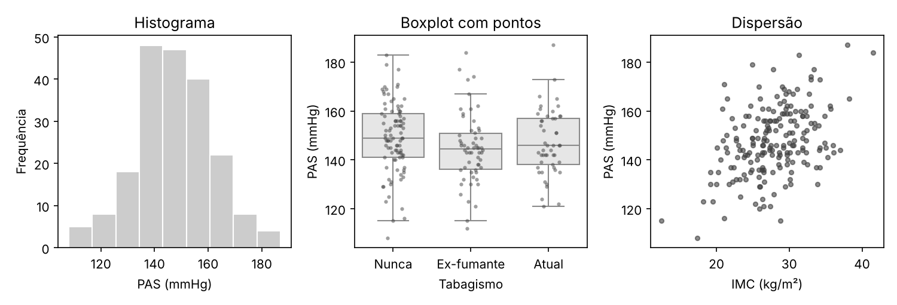

A seaborn também simplifica figuras com paletas acessíveis. A paleta `"colorblind"` é segura para pessoas com deficiência na percepção de cores, e a função `catplot()` combina pontos e médias com intervalos de confiança, como a figura feita com `ggplot2` na seção de visualização:

```python
sns.set_theme(style="ticks", palette="colorblind")
g = sns.catplot(data=pacientes, x="faixa_imc", y="pas", kind="point",
                errorbar=("ci", 95), capsize=0.15, color="black", linestyle="none",
                height=3.5, aspect=1.4)
sns.stripplot(data=pacientes, x="faixa_imc", y="pas", hue="faixa_imc", alpha=0.4,
              size=3, jitter=0.15, legend=False, ax=g.ax, zorder=0)
g.set_axis_labels("Faixa de IMC", "PAS (mmHg)")
g.savefig("images/python_catplot.png", dpi=150)
```

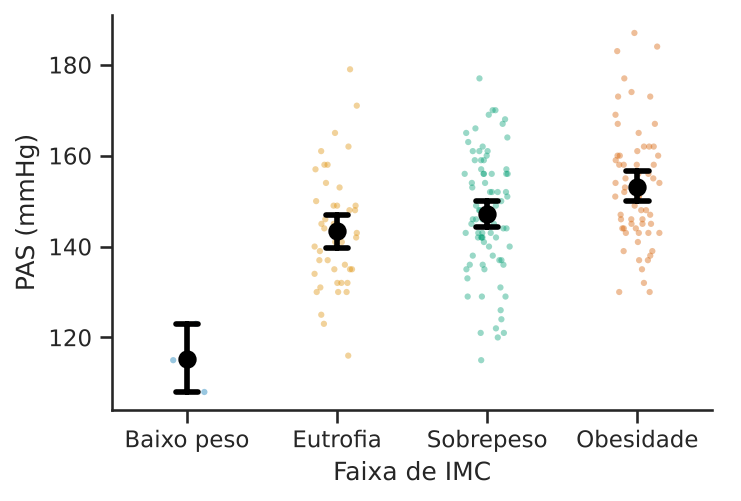

Na faixa de baixo peso há apenas dois pacientes, e por isso o intervalo de confiança é muito largo; mostrar os pontos individuais torna essa limitação visível, o que um gráfico só com médias esconderia.

Para publicação, defina o tamanho final da figura (argumento `figsize`, em polegadas) e salve-a em formato vetorial ou, para imagens matriciais, com a resolução exigida pelo periódico. Por exemplo, `fig.savefig("figura.pdf")` gera um arquivo vetorial, e `fig.savefig("figura.png", dpi=600)`, uma imagem com 600 pontos por polegada. Os princípios da seção de visualização de dados valem integralmente.

### Aprendizado de máquina com scikit-learn

A biblioteca **scikit-learn** oferece uma interface uniforme para centenas de métodos de aprendizado de máquina. Mesmo quem não pretende usar métodos complexos se beneficia de suas ferramentas de **validação**, que implementam corretamente os cuidados discutidos no capítulo *Tópicos avançados em bioestatística*.

O exemplo a seguir retoma a simulação de sobreajuste daquele capítulo: 100 observações, 1.000 preditores sem nenhuma relação com o desfecho. Comparamos uma validação cruzada **incorreta**, em que as 10 variáveis mais associadas ao desfecho são selecionadas usando todos os dados antes da validação, com a validação **correta**, em que a seleção é refeita dentro de cada divisão, como parte de um *pipeline*:

```python
from sklearn.feature_selection import SelectKBest, f_regression
from sklearn.linear_model import LinearRegression
from sklearn.model_selection import cross_val_score, KFold
from sklearn.pipeline import make_pipeline

X = rng.normal(size=(100, 1000))
y = rng.normal(size=100)
cv = KFold(n_splits=5, shuffle=True, random_state=1)

# Incorreto: seleção com todos os dados, antes da validação cruzada
selecionadas = SelectKBest(f_regression, k=10).fit(X, y).get_support()
r2_errado = cross_val_score(LinearRegression(), X[:, selecionadas], y, cv=cv, scoring="r2")

# Correto: seleção dentro de cada divisão da validação cruzada
pipeline = make_pipeline(SelectKBest(f_regression, k=10), LinearRegression())
r2_certo = cross_val_score(pipeline, X, y, cv=cv, scoring="r2")

print(f"R2 médio, seleção fora da validação: {r2_errado.mean():.2f}")
print(f"R2 médio, seleção dentro da validação: {r2_certo.mean():.2f}")
```

Saída:

```
R2 médio, seleção fora da validação: 0.31
R2 médio, seleção dentro da validação: -0.64
```

Com a seleção feita antes da validação cruzada, o modelo parece prever o desfecho, com $R^2$ positivo, embora os dados sejam puro ruído. Com a seleção dentro do *pipeline*, o $R^2$ é negativo, isto é, o modelo prevê pior do que simplesmente usar a média do desfecho, que é a conclusão correta. A classe `Pipeline` garante que todas as etapas (padronização, seleção de variáveis, ajuste) sejam refeitas em cada divisão, e é a forma recomendada de construir modelos preditivos no scikit-learn.

### Notebooks e relatórios reprodutíveis

Assim como o R Markdown no R, o Python dispõe de formatos que reúnem código, resultados e texto:

- **Jupyter Notebooks** (arquivos `.ipynb`) são o formato mais difundido. São excelentes para exploração e ensino, mas exigem disciplina: as células podem ser executadas fora de ordem, e um *notebook* só é reprodutível se, depois de reiniciado o *kernel*, todas as células rodarem em sequência e produzirem os mesmos resultados. Antes de compartilhar um *notebook*, use a opção "Reiniciar e executar tudo";
- **Quarto** produz relatórios, artigos, apresentações, livros e sites a partir de documentos com blocos de Python, R ou ambos, e também converte *notebooks* do Jupyter;
- no próprio R Markdown, com o pacote `reticulate`, blocos ```` ```{python} ```` são executados por um interpretador Python, e objetos podem ser trocados entre as duas linguagens.

Independentemente do formato, as recomendações são as mesmas do R: guarde o código junto com o relatório, gere os números do texto a partir do código, fixe as sementes aleatórias e registre as versões das bibliotecas.

## Visualização de dados e figuras científicas

As seções anteriores mostraram como produzir gráficos em R. Esta seção trata de uma pergunta anterior: como decidir **que** gráfico fazer e como construí-lo para que comunique os dados de forma honesta e clara. Os princípios valem para qualquer programa.

### Começar pela pergunta

Um gráfico científico existe para responder a uma pergunta ou apoiar uma afirmação. Antes de escolher o tipo de gráfico, defina a mensagem: comparar grupos? Mostrar uma distribuição? Uma relação entre duas variáveis? Uma evolução no tempo? A escolha segue a pergunta:

- **distribuição de uma variável quantitativa**: histograma, gráfico de densidade, boxplot com os pontos;
- **comparação de uma variável quantitativa entre grupos**: pontos individuais com uma medida resumo, boxplots, gráficos de violino; com muitos grupos, gráficos de pontos ordenados;
- **comparação de proporções ou contagens entre categorias**: gráficos de barras (com o eixo começando em zero) ou de pontos;
- **relação entre duas variáveis quantitativas**: gráfico de dispersão;
- **evolução no tempo**: gráfico de linhas, com os pontos medidos indicados quando forem poucos;
- **estimativas com incerteza** (por exemplo, coeficientes de modelos ou resultados de metanálises): pontos com intervalos de confiança (gráfico de floresta).

### Como percebemos os gráficos

Cleveland e McGill [-@cleveland1984] estudaram experimentalmente a precisão com que as pessoas decodificam diferentes elementos gráficos. A **posição ao longo de uma escala comum** é julgada com mais precisão; seguem-se, em ordem decrescente, a posição em escalas não alinhadas, o comprimento, o ângulo e a inclinação, a área, o volume e a cor. Daí decorrem orientações práticas: comparações importantes devem ser codificadas por posição (pontos alinhados em um mesmo eixo); gráficos de pizza, que codificam por ângulo e área, permitem comparações imprecisas e devem ser evitados, sobretudo com muitas categorias; efeitos tridimensionais distorcem comprimentos e áreas e nunca devem ser usados para dados bidimensionais.

### Mostrar os dados

O gráfico de barras com a média e uma barra de erro (o *dynamite plot*) ainda é muito comum para comparar grupos com variáveis contínuas, mas esconde a distribuição dos dados [@weissgerber2015]. A Figura \@ref(fig:sw-dinamite) mostra dois grupos com médias semelhantes e distribuições muito diferentes: no grupo B, a média é puxada por três valores altos, e a mediana fica abaixo da do grupo A. O gráfico de barras é praticamente idêntico para os dois grupos; o gráfico de pontos revela a diferença.

```{r sw-dinamite, fig.cap="Os mesmos dados (simulados) em um gráfico de barras com média e erro padrão (esquerda) e em um gráfico de pontos com a mediana (direita). O gráfico de barras esconde a assimetria do grupo B.", fig.width=7, fig.height=3.5}
set.seed(12)
grupo_a <- round(rnorm(12, mean = 50, sd = 6), 1)
grupo_b <- round(c(rnorm(9, mean = 40, sd = 4), rnorm(3, mean = 80, sd = 6)), 1)
medias <- c(mean(grupo_a), mean(grupo_b))
eps <- c(sd(grupo_a), sd(grupo_b)) / sqrt(12)
op <- par(mfrow = c(1, 2), mar = c(4, 4, 1, 1))
centros <- barplot(medias, names.arg = c("A", "B"), ylim = c(0, 100), col = "grey80",
                   ylab = "Resposta", xlab = "Grupo")
arrows(centros, medias, centros, medias + eps, angle = 90, length = 0.1)
stripchart(list(A = grupo_a, B = grupo_b), vertical = TRUE, method = "jitter", jitter = 0.1,
           pch = 19, col = adjustcolor("grey20", alpha.f = 0.7), ylim = c(0, 100),
           ylab = "Resposta", xlab = "Grupo")
segments(c(0.8, 1.8), c(median(grupo_a), median(grupo_b)), c(1.2, 2.2), lwd = 3)
par(op)
```

Com amostras pequenas ou moderadas, mostre todos os pontos. Com amostras grandes, use boxplots, gráficos de violino ou de densidade, e indique o tamanho de cada grupo.

### Cor

A cor deve ter uma função: distinguir grupos, codificar uma variável ou destacar um elemento. Algumas orientações:

- **acessibilidade**: uma fração considerável dos homens (em torno de 8% em populações de origem europeia) tem alguma deficiência na percepção de cores, mais frequentemente na distinção entre vermelho e verde. Use paletas seguras para daltônicos, como a de Okabe e Ito para categorias e a família *viridis* para escalas contínuas, e combine cor com outro elemento (forma do símbolo, tipo de linha) quando possível;
- **escalas contínuas** devem variar de forma perceptualmente uniforme; a paleta "arco-íris" (*jet*) cria fronteiras artificiais e deve ser evitada;
- **escalas divergentes** (por exemplo, azul–branco–vermelho) são apropriadas apenas quando há um ponto central com significado, como o zero de uma diferença;
- verifique se a figura continua legível impressa em tons de cinza.

### Uma figura para publicação com ggplot2

O exemplo a seguir constrói, com o `ggplot2`, uma figura que compara três grupos mostrando os pontos individuais, a média e o intervalo de confiança de 95% da média, com uma paleta segura para daltônicos, rótulos com unidades e um tema limpo.

```{r sw-ggplot, fig.cap="Exemplo de figura para publicação: pontos individuais, média e intervalo de confiança de 95% da média em três grupos (dados simulados).", fig.width=5.5, fig.height=4, message=FALSE}
library(ggplot2)
set.seed(30)
dados_fig <- data.frame(
  grupo = factor(rep(c("Placebo", "Dose baixa", "Dose alta"), each = 15),
                 levels = c("Placebo", "Dose baixa", "Dose alta")),
  reducao = c(rnorm(15, 2, 4), rnorm(15, 6, 4), rnorm(15, 9, 4))
)
resumo_fig <- aggregate(reducao ~ grupo, data = dados_fig, FUN = function(x)
  c(media = mean(x), inf = t.test(x)$conf.int[1], sup = t.test(x)$conf.int[2]))
resumo_fig <- data.frame(grupo = resumo_fig$grupo, resumo_fig$reducao)
okabe_ito <- c("#E69F00", "#56B4E9", "#009E73")

ggplot(dados_fig, aes(x = grupo, y = reducao, colour = grupo)) +
  geom_hline(yintercept = 0, linetype = "dashed", colour = "grey60") +
  geom_jitter(width = 0.12, alpha = 0.6, size = 2) +
  geom_pointrange(data = resumo_fig, aes(y = media, ymin = inf, ymax = sup),
                  colour = "black", size = 0.6, position = position_nudge(x = 0.3)) +
  scale_colour_manual(values = okabe_ito, guide = "none") +
  labs(x = NULL, y = "Redução da pressão sistólica (mmHg)") +
  theme_classic(base_size = 12)
```

Alguns detalhes desse código ilustram princípios gerais: a linha tracejada em zero dá uma referência para interpretar as reduções; os pontos são deslocados horizontalmente (*jitter*) para não se sobreporem; a média e o intervalo são deslocados para o lado dos pontos, para não escondê-los; a legenda de cores foi removida porque os grupos já estão identificados no eixo; o eixo vertical tem a variável e a unidade. A legenda da figura, no texto, deve informar o que os pontos, as médias e as barras representam, e o tamanho de cada grupo.

### Formatos e resolução

- **Gráficos vetoriais** (PDF, SVG, EPS) descrevem a figura por formas geométricas e podem ser ampliados sem perda de qualidade; são o formato preferido para gráficos de dados.
- **Imagens matriciais** (PNG, TIFF, JPEG) são formadas por pixels; para impressão, os periódicos costumam exigir pelo menos 300 pontos por polegada (dpi) no tamanho final para fotografias e de 600 a 1.200 dpi para gráficos de linhas. O formato JPEG, com compressão com perdas, deve ser evitado para gráficos.
- Crie a figura **no tamanho final** em que será publicada (por exemplo, 8,5 cm para uma coluna ou 17,5 cm para a página inteira, conforme o periódico), para que o tamanho das fontes fique legível; reduzir depois uma figura grande deixa os textos minúsculos.

No `ggplot2`, a função `ggsave()` exporta a figura com dimensões e resolução definidas:

```{r sw-ggsave, eval=FALSE}
ggsave("figura1.pdf", width = 12, height = 9, units = "cm")
ggsave("figura1.tiff", width = 12, height = 9, units = "cm", dpi = 600, compression = "lzw")
```

### Lista de verificação

Antes de submeter uma figura, verifique:

1. a figura responde a uma pergunta clara e é necessária (não repete uma tabela)?
2. os dados individuais ou sua distribuição estão visíveis, e não apenas médias?
3. os eixos têm rótulos com unidades, e as escalas são adequadas (eixos de barras começam em zero; escalas logarítmicas estão indicadas)?
4. as barras de erro estão identificadas na legenda (desvio padrão, erro padrão ou intervalo de confiança)?
5. a figura é legível no tamanho final e em tons de cinza, e acessível a pessoas com deficiência na percepção de cores?
6. os tamanhos amostrais de cada grupo estão informados?
7. não há elementos decorativos (sombras, efeitos tridimensionais, grades pesadas) que não carreguem informação?
8. a figura é reproduzível a partir do código e dos dados?

Rougier e colaboradores [-@rougier2014] e o livro de Wilke [-@wilke2019] aprofundam esses princípios.
