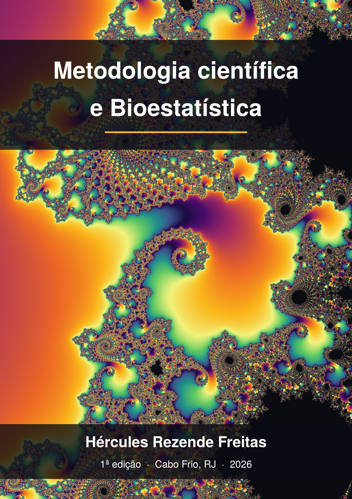

```{r livro-setup, include=FALSE}
# No PDF, as saídas do R são limitadas a 68 caracteres por linha (mais o
# prefixo "## "), para caberem na largura da página.
if (knitr::is_latex_output()) {
  options(width = 68, str = utils::strOptions(strict.width = "wrap"))
}

# Ajusta tabelas largas apenas no PDF (no HTML e no EPUB, a tabela não muda).
# `larguras`: largura de cada coluna (NA mantém a coluna como está), com
# quebra de linha dentro da célula; `reduzir = TRUE`: reduz a tabela inteira
# à largura do texto.
tab_pdf <- function(k, larguras = NULL, reduzir = FALSE) {
  if (!knitr::is_latex_output()) return(k)
  x <- paste(as.character(k), collapse = "\n")
  if (!is.null(larguras)) {
    espec <- regmatches(x, regexpr("\\\\begin\\{tabular\\}\\[t\\]\\{[^}]*\\}", x))
    alinh <- strsplit(sub(".*\\{([^}]*)\\}$", "\\1", espec), "|", fixed = TRUE)[[1]]
    ajuste <- c(l = "\\raggedright", c = "\\centering", r = "\\raggedleft")
    colunas <- ifelse(is.na(larguras), alinh,
                      sprintf(">{%s\\arraybackslash}p{%s}", ajuste[alinh], larguras))
    x <- sub(espec, sprintf("\\begin{tabular}[t]{%s}", paste(colunas, collapse = "|")),
             x, fixed = TRUE)
  }
  if (reduzir) {
    x <- sub("\\begin{tabular}", "\\resizebox{\\linewidth}{!}{\\begin{tabular}", x, fixed = TRUE)
    x <- sub("\\end{tabular}", "\\end{tabular}}", x, fixed = TRUE)
  }
  knitr::asis_output(paste0("\n\n", x, "\n\n"))
}
```

```{r capa-html, echo=FALSE, results="asis"}
# No site (gitbook), a capa é a primeira página. No EPUB, a capa é definida
# por `cover_image`; no PDF, por latex/capa-folha-rosto.tex.
if (knitr::pandoc_to(c("html", "html4", "html5"))) {
  cat('# Capa {-}',
      '',
      '<style>#header, #capa h1 { display: none; }</style>',
      '<div style="text-align: center;">',
      '',
      '</div>',
      '', sep = "\n")
}
```

```{r ficha-tecnica, echo=FALSE, results="asis"}
if (!knitr::is_latex_output()) {
  cat(readLines("frontmatter/ficha_tecnica.md", encoding = "UTF-8"), sep = "\n")
}
```

# Sobre o projeto

**O autor**

É Professor Adjunto de Metodologia Científica na Faculdade de Ciências Médicas da Universidade do Estado do Rio de Janeiro (FCM/UERJ), onde também atua como Coordenador de Pesquisa, no campus de Cabo Frio. Coordena o Laboratório de Informática em Saúde (LabInfoS) e o Núcleo Bertrand Russell para Excelência Científica (NEC/UERJ), além de integrar o corpo docente do Programa de Pós-Graduação em Ciências Médicas (PGCM/UERJ). Exerce, ainda, a função de bioestatístico no Instituto Nacional de Traumatologia e Ortopedia Jamil Haddad (INTO).

Sua formação acadêmica abrange diferentes áreas do conhecimento. É licenciado em Ciências e em Matemática, bacharel em Biologia e em Nutrição, mestre e doutor em Biofísica pela Universidade Federal do Rio de Janeiro (UFRJ), com grau acadêmico também pela Universidade de Coimbra. Realizou estágio pós-doutoral em Neuropatologia no MIND Institute, da University of California, Davis, sob a supervisão do Dr. Lee-Way Jin e da Dra. Izumi Maezawa. Atuou, ainda, como pesquisador visitante no Multidisciplinary Institute of Ageing, da Universidade de Coimbra.

Ao longo de sua trajetória, foi contemplado com bolsas e auxílios de pesquisa concedidos por instituições nacionais e internacionais, incluindo a Coordenação de Aperfeiçoamento de Pessoal de Nível Superior (CAPES-BR), o Conselho Nacional de Desenvolvimento Científico e Tecnológico (CNPq-BR), o National Institutes of Health (NIH-EUA), a Tess Research Foundation (TRF-USA) e o Coimbra Group (CG-EU).

Sua produção científica inclui a coautoria de livros de referência, como *Nutritional Neuroscience* e *Omega Fatty Acids in Brain and Neurological Health*, publicados pela Academic Press, e *Neurociência da mente e do comportamento*, publicado pela Guanabara Koogan. Atua como revisor de periódicos científicos internacionais, entre eles *British Journal of Pharmacology*, *Frontiers in Neuroscience*, *Neurochemical Research*, *BMJ Open* e *Food Research International*. Também integra o corpo editorial das revistas *Frontiers in Nutrition* e *Frontiers in Neuroscience* e atua como consultor ad hoc na avaliação de projetos submetidos ao Natural Sciences and Engineering Research Council of Canada (NSERC).

<br />

**Metodologia científica e Bioestatística**

O projeto "Metodologia científica e Bioestatística" é de acesso aberto e está aberto a colaborações. Esta primeira edição foi escrita por um único autor; o objetivo é que o texto seja continuamente atualizado e que todas as pessoas que vierem a contribuir sejam reconhecidas pelo seu trabalho.

*Proposta e público*

Este livro reúne, em um único texto, os fundamentos da metodologia científica e da bioestatística aplicados às ciências da saúde e da vida. Foi pensado para estudantes de graduação e de pós-graduação em medicina, enfermagem, nutrição, biologia, farmácia e áreas afins, e para pesquisadores e profissionais que precisam planejar estudos, analisar dados ou ler criticamente a literatura científica. O texto procura ser rigoroso sem pressupor formação matemática avançada: as fórmulas são apresentadas e justificadas, os cálculos são feitos passo a passo em exemplos pequenos e, em seguida, reproduzidos em R com conjuntos de dados maiores.

*Organização*

Os capítulos seguem a ordem em que as decisões aparecem em uma pesquisa:

- **Introdução à metodologia científica** e **Formulação de problemas e hipóteses** tratam da natureza do conhecimento científico, da construção da pergunta de pesquisa, da revisão da literatura, dos objetivos e das hipóteses;
- **Desenhos de pesquisa** apresenta as medidas de frequência e de associação, as ameaças à validade (erro aleatório, viés e confusão) e os principais desenhos observacionais, experimentais e de ensaios clínicos;
- **Bioestatística descritiva**, **Bioestatística inferencial** e **Relações entre variáveis** formam o núcleo estatístico do livro: descrição de dados, probabilidade, distribuições, intervalos de confiança, testes de hipóteses, correlação, regressão, análise de variância e métodos multivariados;
- **Uso de softwares estatísticos** introduz o R, o Python, os programas com interface gráfica e os princípios de construção de figuras científicas;
- **Comunicação científica** e **Ética e boas práticas em pesquisa** tratam da redação, da publicação, da integridade e da regulamentação da pesquisa no Brasil;
- **Aplicações práticas e estudos de caso** e **Tópicos avançados em bioestatística** aplicam e estendem os métodos a problemas de epidemiologia, genética, ecologia e farmacologia, e introduzem modelos lineares generalizados, modelos mistos, análise de sobrevivência, inferência bayesiana, dados de alta dimensão e metanálise;
- **Recursos adicionais** reúne bibliografia comentada, glossário, tabelas estatísticas e endereços úteis.

*Como ler este livro*

Os capítulos podem ser lidos de forma independente, mas os de bioestatística pressupõem os anteriores: a inferência usa os conceitos da estatística descritiva, e o estudo das relações entre variáveis usa os da inferência. Cada capítulo termina com um resumo, exercícios e respostas comentadas. Recomenda-se tentar resolver os exercícios antes de consultar as respostas e reproduzir no próprio computador os códigos apresentados.

Algumas convenções são usadas ao longo do texto:

- no texto, os números usam vírgula como separador decimal; nas saídas do R e do Python, ponto;
- letras gregas ($\mu$, $\sigma$, $\pi$) indicam parâmetros populacionais, e letras latinas ($\bar{x}$, $s$, $\hat{p}$), estatísticas calculadas nas amostras;
- os conjuntos de dados usados nos exemplos são fictícios ou simulados, construídos para ilustrar os métodos, e isso é indicado em cada caso. Nenhum deles corresponde a pessoas reais.

*Reprodutibilidade*

O livro é escrito em R Markdown e compilado com o pacote **bookdown**. Os números citados no texto que dependem de análises são, sempre que possível, gerados diretamente pelo código no momento da compilação, e todas as simulações usam sementes fixas (`set.seed()`), de modo que qualquer leitor obtém exatamente os mesmos resultados. Esta versão foi compilada em `r format(Sys.Date(), "%d/%m/%Y")`, com `r R.version.string`. Os arquivos-fonte estão disponíveis no repositório do projeto: <https://github.com/drhrf/MCBS>.

*Como contribuir*

Contribuições são bem-vindas: novos conteúdos, revisão de seções, correção de erros, sugestões de exemplos ou exercícios. Elas podem ser enviadas por e-mail ao autor (<hercules.freitas@uerj.br>) ou propostas diretamente no repositório do projeto, por meio de *issues* ou *pull requests*. Todas as pessoas que contribuírem com conteúdo serão reconhecidas como coautoras das seções correspondentes, e as contribuições de revisão serão registradas nos agradecimentos.

*Como citar*

Freitas HR. *Metodologia científica e Bioestatística* [livro eletrônico]. 1. ed. Cabo Frio, RJ: edição do autor; 2026. Disponível em: <https://drhrf.github.io/MCBS/>.

Ao citar um capítulo específico, indique também o título e o número do capítulo.
